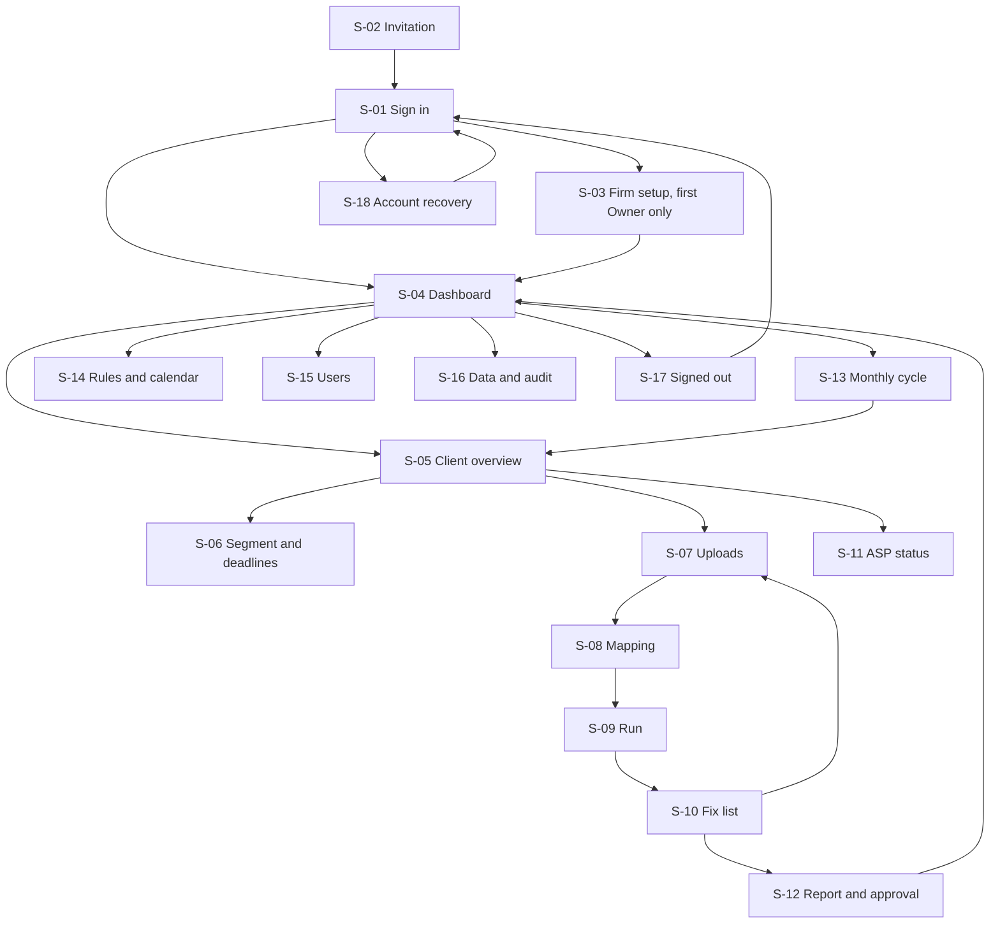

# App flow — PINT AE Readiness Desk

Roles and must-haves: [PRD.md](PRD.md). Endpoints: [TRD.md section 5.1](TRD.md#51-api-contracts-proposed-prefix-apiv1-json-cursor-pagination). Visual treatment: [design.md](design.md). All screens are proposed; none exists. O = Owner, R = Reviewer, P = Preparer. Vendor support sees what its grant allows, read-only, through the vendor routes of TRD §5.1; vendor publication has no screen in the firm application (a command-line client against the vendor routes).

## 1. Screen and route inventory

| ID | Route | Screen | Roles | MH |
|---|---|---|---|---|
| S-01 | `/login` | Sign in | All | MH-01 |
| S-02 | `/invite/{token}` | Accept invitation, set password, enrol TOTP | Invitee | MH-01 |
| S-03 | `/setup` | Firm setup | O | MH-01, MH-11 |
| S-04 | `/clients` | Cross-client dashboard | O, R, P | MH-09 |
| S-05 | `/clients/new`, `/clients/{id}` | Client entity overview | O, R, P | MH-02, MH-08 |
| S-06 | `/clients/{id}/segment` | Segment and deadlines | P proposes; R, O approve | MH-02, MH-03 |
| S-07 | `/clients/{id}/uploads` | Uploads | P, R, O | MH-04 |
| S-08 | `/uploads/{id}/mapping` | Column and value mapping | P confirms; R, O approve columns and value tables | MH-05 |
| S-09 | `/clients/{id}/runs/{runId}` | Run progress and result | O, R, P | MH-06 |
| S-10 | `/clients/{id}/findings` | Fix list and finding detail | P works; R decides exceptions | MH-07, MH-10 |
| S-11 | `/clients/{id}/asp` | ASP status | R, O edit; P reads | MH-10 |
| S-12 | `/clients/{id}/reports/{reportId}` | Report review and approval; handoff pack | P drafts; R, O approve | MH-11, MH-15 |
| S-13 | `/cycles/{yyyy-mm}` | Monthly cycle | R, O close; P works | MH-13 |
| S-14 | `/rules` | Rule packs and calendar | All read | MH-03, MH-12 |
| S-15 | `/settings/users` | Users and roles | O | MH-01 |
| S-16 | `/settings/data` | Audit log, export, deletion, support grants | O; R reads audit | MH-14 |
| S-17 | `/signed-out` | Signed out or session expired | All | MH-01 |
| S-18 | `/recover`, `/recover/{token}` | Account recovery | Anyone with an account | MH-01 |

## 2. Navigation

## 3. Screens

Each entry: story; entry conditions; inputs; visible data; actions → destinations; acceptance checks.

**S-01 Sign in.** Story: as a user I sign in with password then TOTP. Entry: none; a deep link is kept and restored after sign-in. Inputs: email, password, 6-digit code (paste allowed, password managers allowed). Visible: generic failure message that does not reveal which part failed. Actions: Sign in → requested URL or S-04; "Cannot sign in?" → S-18. Checks: five failures in 15 minutes delay further attempts; the requested URL is restored only if it is a route of this application.

**S-02 Invitation.** Story: as an invitee I activate my account. Entry: unused token under 24 hours old; otherwise "This link has expired; ask your firm's Owner for a new one." Inputs: password of at least 12 characters, TOTP enrolment code. Visible: firm name, role granted, ten recovery codes shown once to every user with a "I have stored these" tick. Actions: Activate → S-01. Checks: token works once; a breached password is refused with a reason.

**S-03 Firm setup.** Story: as the first Owner I set the firm's name, report branding and data-authority statement. Entry: first Owner, setup incomplete. Inputs: firm legal name, logo (PNG, at most 1 MB), report footer, the telephone number for Owner recovery (from the pilot agreement), tick-box "we are authorised by each client to process its data here". Actions: Save → S-04. Checks: uploads are blocked until the statement is ticked; the tick is an audit event.

**S-04 Dashboard.** Story: as an Owner I see which clients are at risk, most urgent first. Entry: signed in. Inputs: filters (segment, data status, ASP status, text), sort; all held in the URL. Visible per row: client name, segment, appoint-by and implement-by dates with calendar version (always the current published calendar, also for Stale rows), days remaining, data status, readiness score, open blockers, unchecked rules, ASP status, last run date; header totals by status; a banner when any entity is Stale; a "Reports to re-issue" count. Actions: open row → S-05; Add client → S-05 new; batch "Re-run stale" (R, O) → per-entity result list; Export view (.xlsx). Checks: totals equal the row count; default sort puts entities past their governing appoint-by date without an appointment first, then ascending days remaining; a SEG-U row shows "Segment not confirmed", both outcomes ("if AED 50M or more: 30 October 2026, passed; if below: 31 March 2027") and is sorted and counted by the earlier one, so it sits in the overdue group until confirmed; a SEG-N row shows "before first invoice"; batch re-run reports each entity as started, skipped with reason, or failed.

**S-05 Client overview.** Story: as a Preparer I see one client's whole state and the next step. Entry: entity in my firm, else 404. Inputs (new; this is the seller profile checked by RC-01 to RC-04): legal name, registration type (trade licence, Emirates ID, passport, Cabinet decision, unknown), licence number and authority, address line, city, emirate, country, VAT-registered yes/no/unknown, TRN or TIN if known, source ledger (Excel, QuickBooks, Odoo, other). Visible: status with the reason it is not Data-ready, the three datasets and their latest upload, latest run, open findings by rule, segment card, ASP card, reports. Actions: Classify segment → S-06; Upload → S-07; View fix list → S-10; Record ASP → S-11; Draft report → S-12; Delete entity (O) with typed confirmation → S-04. Checks: "unknown" is accepted for every profile item and shows "this makes RC-0x not checked, which blocks Data-ready"; the next-step prompt matches the status; a duplicate TRN within the firm warns and links to the existing entity.

**S-06 Segment and deadlines.** Story: as a Reviewer I approve the legal segment so that the right dates apply. Entry: entity exists. Inputs: entity type (person, government entity), newly established yes/no and, if yes, first-invoice date or "not yet issued" or "unknown", exclusively business-to-consumer yes/no, Revenue band (at or above AED 50M, below, unknown), accounting period end, evidence type (financial statements, other documentation, client statement), note. Visible: resulting segment, both dates, calendar version and source line, the Revenue definition quoted from the decision, version history, the proposal awaiting approval. Actions: Propose (P) → stays, status "awaiting approval"; Approve or Return with reason (R, O) → S-05. Before approval the Reviewer sees: the proposed band, evidence type, period end, the dates that will apply, and the reports that will become superseded. Checks: a proposal changes nothing until approved; "unknown" yields SEG-U with both outcomes shown and the earlier date governing; approving a band at or above AED 50M shows that both SEG-L dates have passed or are imminent; every approval is a new version.

**S-07 Uploads.** Story: as a Preparer I upload the customer, item and invoice exports. Entry: firm setup complete. Inputs: dataset type, file (.xlsx or .csv, at most 20 MB), sheet selection, header row number, period covered for invoices. Visible: per dataset the latest accepted upload, row count, hash prefix, who and when; earlier uploads; rejected files with reasons. Actions: Upload → S-08 when parsed; Replace; Retry a failed parse; Remove an upload that no approved report depends on. Checks: the moment the third dataset is parsed and the seller profile exists, the entity's intake-complete time is recorded (M-04); the same bytes uploaded again show "Already uploaded on {date}" and create nothing; three files dropped together are listed with one outcome each; a failed parse offers Retry and keeps the file.

**S-08 Mapping.** Story: as a Preparer I confirm which column feeds which field, and as a Reviewer I approve it. Entry: upload parsed. Inputs: per target field a source column, "not in this file", or blank; value tables for units, emirates, tax treatments, document types, buyer classes. Visible: suggested mapping with the reason (header match, value pattern), five sample values per column, fields that will be unchecked and the rules affected, reuse notice when the header fingerprint matches a confirmed mapping. Actions: Confirm (P) → run starts → S-09; Save draft; Approve or Return column mapping and value tables (R, O), each field shown with its five sample values. Checks: no run starts without confirmation; a Preparer cannot approve; a report cannot be approved while any mapping it used is unapproved; changing a mapping creates a new version that needs approval again and makes results Stale; a field marked "not in this file", an unmapped column and a value with no approved mapping each produce "not checked" results that are listed as findings and block Data-ready, never silently dropped. At 320 CSS px each field is a stacked card (field, select, samples); nothing is withheld on small screens.

**S-09 Run.** Story: as a user I see that the check is running and what it found. Entry: run exists. Visible: state (queued, running, succeeded, failed), rows processed, pack version, counts by rule and severity of failed and of not-checked results, records out of scope and why, link to the fix list. Actions: View fix list → S-10; Retry (failed only). Checks: the page can be closed and reopened; a finished run shows the same result after refresh; a failed run states that earlier results remain in force.

**S-10 Fix list.** Story: as a Preparer I work through findings and see exactly where each came from. Entry: at least one run. Inputs: filters (rule, severity, dataset, state, "ASP also flagged"), search; in the URL. Visible per finding: rule ID and plain description, outcome (failed or not checked, with the reason it could not be checked), source file, sheet, row, column, value found, expected form, source reference, state (open, fixed in a later run, exception proposed, exception accepted, exception rejected), history. Self-billed documents (codes 389, 261) appear under "Manual review" and block Data-ready until resolved; once confirmed they are counted on every report as not assessed. An exception cannot be proposed for a not-checked result; it is cleared only by supplying and mapping the field. Actions: Export fix list (.xlsx); mark "ASP also flagged this" (R); Propose exception with reason (P); Accept or Reject exception (R, O); Resolve manual-review records (R, O): "confirm self-billed, not assessed" or "correct the document type"; batch propose exception for selected findings of one rule; Re-upload → S-07. Checks: an accepted exception stays in the list under "Exceptions", keeps the entity out of Data-ready, and does not hide other findings on the same record; findings close only when a later run no longer produces them; batch actions return a per-item result.

**S-11 ASP status.** Story: as a Reviewer I record whether the client has appointed an ASP and how far onboarding has gone. Inputs: status, ASP name (type-ahead from the MoF list snapshot, or free text), appointment date, EmaraTax onboarding done, go-live date, evidence note. Visible: appoint-by date and days remaining for the segment; history. Actions: Save → S-05. Checks: an appointment date after the appoint-by date is accepted and flagged "after the legal date"; no file upload is required.

**S-12 Report and approval.** Story: as a Reviewer I approve the report the firm will send its client. Entry: a run exists; draft can be made at any status. Visible: full preview, DRAFT watermark, status, score, open blockers, unchecked rules and exceptions listed in full, segment and dates, the column mappings and value tables used with sample values and who approved them, versions, reference code, disclaimer; a diff against the previous approved report; a lookup box that shows Current or Superseded for any report code. Before approval the Reviewer reviews: status, every exception, every unchecked rule, the segment, the mappings, the versions, and the disclaimer. Actions: Approve (R, O) → file generated, status "Approved"; Return to Preparer; Download; Mark delivered to client (records the delivery time for M-04); Build handoff pack (enabled only when the customer and item datasets have no open blocker) → download. Checks: approval fails with "Results are out of date; re-run" if any version changed, with "Mapping not approved" if one is pending, and with "Approvals are paused" during an incident freeze; an approved report is immutable; a report never states "Data-ready" unless the status is; sending to the client happens outside the product.

**S-13 Monthly cycle.** Story: as a Reviewer I run and close this month's cycle. Entry: account past pilot day 30 or subscribed. Visible: entities with new or changed master data, stale entities, rejections logged, new entities, changes since last cycle, each with a done mark. Inputs: rejection entry (entity, invoice number, date, cause from a list, ASP message text). Actions: open entity → S-05; Re-run stale; Close cycle (R, O) → summary generated. Checks: a cycle cannot close with stale entities unless each has a recorded reason; the summary lists status changes in both directions.

**S-14 Rules and calendar.** Story: as a Reviewer I see which rules and dates are in force and where they come from. Visible: calendar versions with source lines and the recorded 30 or 31 October discrepancy; provisions PRV-1 to PRV-4 with their dates; rule packs with basis, release date, effective date and its label; each rule with reference and severity; what changed between versions. Actions: none for firm users. Checks: every date and rule shows a source; withdrawn versions remain listed.

**S-15 Users.** Story: as an Owner I invite and remove staff. Inputs: email, role. Actions: Invite, change role, disable, Reset sign-in (issues a new invitation). Checks: disabling ends sessions at once; the last Owner cannot be disabled.

**S-16 Data and audit.** Story: as an Owner I export, delete and audit. Visible: audit log with filters; exports with expiry; vendor support grants. Actions: Request export; Grant support access (scope, hours); Revoke; Delete firm data (typed confirmation, 7-day delay **[P]**); Cancel a pending deletion. Checks: exports contain only this firm's data; a grant expires by itself.

**S-18 Account recovery.** Story: as a user who cannot sign in I regain access without weakening sign-in. Entry: from S-01. Inputs: email; then, by case, new password plus TOTP code, or password plus one recovery code followed by TOTP re-enrolment. Visible: the same neutral message whether or not the email exists; for "I have lost both", who to ask: the firm's Owner, or for a sole Owner the vendor, with the call-back and 24-hour wait explained. Actions: Request reset link → email; Complete reset → S-01; Use recovery code → TOTP enrolment → S-04. Checks: a reset link works once for 20 minutes; a reset never signs the user in without TOTP or a recovery code; a recovery code works once; recovery events are in the audit log and notified to the Owner.

**S-17 Signed out.** Reached by Sign out or expiry. Shows "You have been signed out" or "Your session expired; sign in to continue where you were", with the saved return URL.

## 4. States that apply across screens

| State | Behaviour |
|---|---|
| Empty | S-04 with no clients shows the three steps and Add client; S-10 with no findings says whether that is because nothing ran or nothing failed |
| Loading | Table skeleton; no layout shift; announced once |
| Processing | S-09 polls every 3 seconds, slowing to 15; the user may leave |
| Partial success | Multi-file upload, batch re-run and batch exception each show per-item outcomes and a "retry failed only" action |
| Validation error | Field-level text, focus moved to the first error, input kept |
| Permission denied | In-app page "You do not have access to this" with a link to the dashboard; foreign identifiers give "Not found" |
| Timeout | "This is taking longer than usual. The check continues; this page will update." Never a second submission |
| Retry | Offered only for failed items; uses the same idempotency key |

## 5. Navigation behaviour

- **Refresh:** every screen rebuilds from the server; drafts of mapping and segment proposals are saved on change.
- **Back and Forward:** filters, sort, page cursor and the open finding are URL parameters; Back from a finding returns to the same list position.
- **Deep links:** every route above is linkable; an unauthenticated visit returns to it after sign-in; a link to a superseded report opens it with a banner and a link to the current one.
- **Duplicate submission:** upload, run, approve and close-cycle buttons disable on click and send an idempotency key; a repeat returns the first result.
- **Batch actions:** selection is by explicit rows or "all matching the filter" with the count shown before confirming.
- **Reopening unfinished work:** S-05 shows the next step; an unconfirmed mapping, an unapproved segment proposal and a draft report each appear as "Waiting for you" on S-04 for the responsible role.
- **Irreversible or external actions:** approving a report, accepting an exception, approving a segment, closing a cycle, deleting an entity. Each shows what will change and for whom before confirmation, as listed on its screen. The product sends nothing to clients, ASPs or the FTA.
- **Sign-out:** ends the server session, clears client state, lands on S-17.
