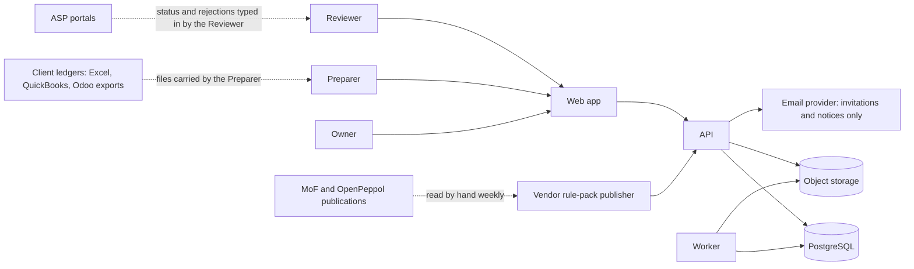
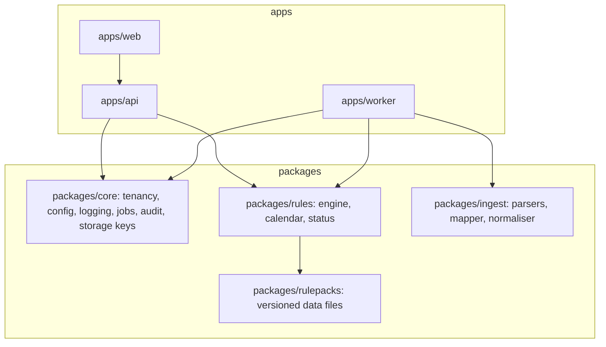
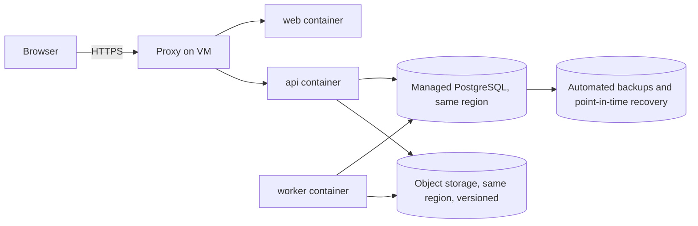

# TRD — PINT AE Readiness Desk

arc42 order. Labels: [Decision.md section 0](Decision.md#0-labels). Requirements: [PRD.md](PRD.md). Risks R-01 to R-22 live only in [verification-report-fixing.md](verification-report-fixing.md#5-production-risk-register). Nothing here exists; every command, script and environment is **proposed**.

## 1. Introduction and goals

Deliver MH-01 to MH-15 for a pilot of up to 30 client entities per firm. Quality goals in order: (1) correctness of status, segment and deadline (no False Ready, PRD section 7); (2) tenant isolation; (3) reproducibility of every result from stored versions; (4) low operating cost for one founder.

## 2. Constraints

Data stays in a UAE cloud region [C]. Not an ASP: no transmission, no XML [C]. One to three developers [C]. Fixed-cost budget AED 3,200 a month [C-model]. Dates, money, access and eligibility are computed by deterministic code. English interface.

## 3. Context and scope



External systems are deliberately few. There is no connection to any ASP, the FTA, EmaraTax, QuickBooks or Odoo in the MVP (PRD section 2).

## 4. Solution strategy

| Concern | Choice | Tradeoff |
|---|---|---|
| Frontend | Next.js (TypeScript), server-rendered, table-heavy [C suggestion] | Heavier than plain templates; chosen for URL-driven state and accessible table components |
| Backend | Python 3.12, FastAPI, SQLAlchemy 2, Alembic [C suggestion] | Python's `decimal` and spreadsheet libraries fit the rule engine |
| Database | PostgreSQL 16 with row-level security | One store for data, jobs and audit; no Redis to operate |
| Storage | S3-compatible private bucket in the same region; files streamed through the API | No pre-signed links, so no link-host problem; API carries download load |
| Jobs | `jobs` table, `FOR UPDATE SKIP LOCKED`, one worker process | Simple and transactional; revisit above about 50 firms |
| AI | None in the MVP (AD-06) | Departs from the brief's small-model suggestion; see section 8.9 |
| Testing | pytest with Hypothesis; Playwright with axe-core | — |
| Hosting | One VM (Docker Compose: proxy, web, api, worker) plus managed PostgreSQL and object storage in AWS me-central-1 [C suggestion] | Single VM is a single point of failure; accepted for the pilot |
| DevOps | GitHub Actions: lint, tests, migration checks, image build; deploy by tagged image | Manual promotion to production |

## 5. Building blocks



Rules: apps import only the public interface of packages; `api` and `worker` never import each other; `packages/core` imports no web framework (R-04, R-06, R-07). The status function, calendar lookup and rule engine exist once, in `packages/rules` (R-03).

### 5.1 API contracts (proposed, prefix `/api/v1`, JSON, cursor pagination)

| Area | Endpoints | Screen |
|---|---|---|
| Auth | `POST /auth/login`, `POST /auth/totp`, `POST /auth/logout`, `GET /auth/session` (current user and anti-forgery token), `POST /invites`, `GET /invites/{token}` (firm, role, address), `POST /invites/{token}/accept` | S-01, S-02, S-15, S-17 |
| Recovery | `POST /auth/password-reset` (request), `POST /auth/password-reset/{token}` (complete; TOTP or recovery code still required), `POST /auth/recovery-code`, `POST /auth/recovery-codes/regenerate`, `POST /users/{id}/reset` (Owner), `POST /vendor/owner-resets` and `POST /vendor/owner-resets/{id}/complete` | S-18, S-15 |
| Firm | `GET, PUT /firm`; `PUT /firm/logo` | S-03 |
| Users | `GET /users`; `PATCH /users/{id}` (role, disable); a user is added only by `POST /invites` | S-15 |
| Entities | `GET, POST /entities`; `GET, PATCH, DELETE /entities/{id}`; `GET /dashboard`; `POST /dashboard/exports` | S-04, S-05 |
| Segment | `POST /entities/{id}/segment-assessments`; `POST /segment-assessments/{id}/decision` | S-06 |
| Reference | `GET /calendar-versions`; `GET /provisions`; `GET /rule-packs`; `GET /asp-directory` | S-14, S-11 |
| Uploads | `POST /entities/{id}/uploads` (multipart, `Idempotency-Key`); `GET /entities/{id}/uploads`; `GET, DELETE /uploads/{id}`; `POST /uploads/{id}/retry`; `GET /uploads/{id}/rows` | S-07, S-10 |
| Mapping | `GET, PUT /uploads/{id}/mapping`; `POST /uploads/{id}/mapping/confirm`; `POST /mappings/{id}/decision`; `GET, PUT /entities/{id}/value-mappings`; `POST /entities/{id}/value-mappings/decision` | S-08 |
| Runs | `POST /entities/{id}/runs` (`Idempotency-Key`); `POST /runs/batch`; `GET /runs/{id}`; `POST /runs/{id}/retry` | S-09, S-04, S-13 |
| Findings | `GET /entities/{id}/findings`; `PATCH /findings/{id}`; `POST /findings/{id}/exceptions`; `POST /findings/exceptions/batch`; `POST /exceptions/{id}/decision`; `POST /findings/review-resolutions` (Reviewer resolves manual-review records, singly or in batch); `POST /entities/{id}/findings/exports` | S-10 |
| ASP | `GET, PUT /entities/{id}/asp-status` | S-11 |
| Reports | `POST /entities/{id}/reports`; `GET /reports/{id}`; `POST /reports/{id}/approve`; `POST /reports/{id}/return`; `POST /reports/{id}/delivered`; `GET /reports/lookup?code=`; `POST /entities/{id}/handoff-packs`; `GET /files/{id}` | S-12 |
| Cycle | `GET /cycles/{yyyy-mm}`; `POST /cycles/{yyyy-mm}/close`; `GET /cycles/{yyyy-mm}/rejections`; `POST /entities/{id}/rejections` | S-13 |
| Governance | `GET /audit-events`; `GET, POST /exports`; `GET, POST /support-grants`; `DELETE /support-grants/{id}`; `GET, POST /deletion-requests`; `DELETE /deletion-requests/{id}` | S-16 |
| Vendor (separate sign-in, section 8.1) | `POST /vendor/auth/login`, `POST /vendor/auth/totp`; `POST /vendor/rule-packs/{code}/publish`; `POST /vendor/calendar-versions/{code}/publish`; `POST /vendor/flags/approvals-frozen`; `GET /vendor/support/{grant_id}/...` (read-only mirror of the firm GET routes) | None in the firm application |
| Health | `GET /healthz`, `GET /readyz` | — |

Built in B2 (2026-11-11): every Auth row; from Recovery `POST /auth/password-reset`, `POST /auth/password-reset/{token}`, `POST /auth/recovery-code`, `POST /auth/recovery-codes/regenerate`; the Users rows; `POST /entities/{id}/findings/exports` and `GET /files/{id}`. `POST /users/{id}/reset` was added after review round 4 (B2-001). Not built yet: the vendor routes (vendor sign-in, Owner resets, support sessions); until then the firm's first Owner is invited by the vendor script `scripts/create_firm.py` and publication runs through `scripts/load_rulepack.py`.

Every action on every screen in App-flow.md maps to a row above; the tenant and permission suite (T-5.1.1) is generated from this table, so a route missing here fails the suite's inventory check.

Conventions: unknown or foreign identifiers return 404; a stale version pin returns 409 with the current versions; validation errors return 422 with field paths; long work returns 202 with a job identifier; every mutating request carries a correlation identifier that the API generates if absent.

## 6. Runtime view

### 6.1 Normal sequence: upload to approved report

```mermaid
sequenceDiagram
  participant P as Preparer
  participant A as API
  participant D as PostgreSQL
  participant S as Storage
  participant K as Worker
  participant R as Reviewer
  P->>A: POST upload (Idempotency-Key, file)
  A->>S: put object under tenant key
  A->>D: upload row + parse job (one transaction)
  A-->>P: 202 job id
  K->>D: claim job (SKIP LOCKED, lease)
  K->>S: read file
  K->>D: staged rows, header fingerprint, suggested mapping
  P->>A: confirm mapping
  P->>A: POST run (Idempotency-Key)
  K->>D: findings + snapshot + job succeeded (one transaction, pins pack, segment, mapping, profile versions)
  R->>A: approve report (sends pinned versions)
  A->>D: compare pins with current; write approval + audit
  A-->>R: 200 approved, or 409 stale
```

### 6.2 Highest-consequence failure sequence: False Ready prevented

```mermaid
sequenceDiagram
  participant V as Vendor publisher
  participant A as API
  participant D as PostgreSQL
  participant K as Worker
  participant R as Reviewer
  Note over R: Entity shows Data-ready under RP-1
  V->>A: publish RP-2
  A->>D: new version row + notify_stale job (one transaction)
  Note over K: notify_stale fails or never runs
  R->>A: GET dashboard
  A->>D: read snapshot pins, current versions, today's date
  A-->>R: Stale (derived on read), deadlines from the current calendar
  R->>A: approve a report with pins RP-1
  A->>D: shared versions lock and entity row lock, then compare pins with current versions
  A-->>R: 409 Stale: re-run required
  R->>A: GET approved report made under RP-1
  A-->>R: Superseded (derived on read); listed under Reports to re-issue
```

Staleness never depends on a job. The status function receives the stored result, the current published versions and today's date, and returns the effective status on every read (AD-11). The `notify_stale` job only writes audit events and the "Reports to re-issue" notice; if it fails, every screen and the report lookup are still correct, and an alert fires on the failed job (IT-17). The same derivation covers a changed segment version, mapping version or seller-profile version and data older than 45 days. A new calendar version also makes results Stale, because a run applies the calendar's provisions (PRV-2) and pins the calendar version it used; displayed dates change at once and reports that pinned the old calendar read as Superseded (B1 review B1-001). A newer upload makes the result Stale from the moment it is received, before the worker parses it (B1-005). Approval serialises against version changes: it takes a shared advisory lock that publication takes exclusively, and the entity row lock that every change to a pinned version takes, then compares pins (B1-009).

What the product cannot reach: a PDF already sent to a client. Each report therefore carries a reference code and the sentence in MH-11; the firm checks the code on S-12, which shows Current or Superseded. The firm, not the product, re-issues.

### 6.3 Jobs, retries, timeouts, idempotency

| Job | Trigger | Timeout | Retries | Idempotency |
|---|---|---|---|---|
| `parse_upload` | Upload accepted | 5 min | 3, backoff 30 s, 2 min, 10 min | Upload unique on (firm, entity, dataset, sha256) |
| `run_checks` | User or cycle | 10 min | 2 | Run unique on (entity, pack, segment version, mapping versions, seller-profile version, calendar version, dataset hashes); the calendar version is part of the input hash, so a new calendar gives a new run; findings replaced inside the run's transaction |
| `render_report`, `build_export`, `build_handoff` | User | 5 min | 3 | Output keyed by content hash |
| `notify_stale` | Publication, segment or mapping change; daily for the 45-day rule | 5 min | 5 | Writes notices and audit events only; repeatable; status never depends on it |
| `sweep_expired`, `delete_entity` | Schedule, Owner | 10 min | 5 | Deletes by key; repeatable |

A job row has `state`, `state_version`, `attempt_id`, `lease_expires_at`. Transitions are compare-and-set on `state_version`; only the holder of the current `attempt_id` may write a result. A lease that expires returns the job to `queued` with a new attempt. A completion from an attempt that is still current is accepted even after the interface stopped waiting; a completion from a superseded attempt is discarded and logged. Browser requests never wait on a job: they poll `GET /runs/{id}`.

## 7. Deployment view



| | Local | Staging | Production |
|---|---|---|---|
| Data | Synthetic fixtures only | Synthetic only | Customer data |
| Database, storage | Containers with named volumes | Managed, same region | Managed, same region, backups on |
| Email | Captured locally | Sandbox | Provider |
| Secrets | `.env` from a checked-in example without values | Secret store | Secret store; rotated on staff change |
| Start (proposed) | `make dev`: starts all services, waits for `/readyz` | Tagged image | Tagged image after staging checks |

Configuration is read once by `packages/core/config`, validated at start, and includes `PUBLIC_BASE_URL`; start fails on a missing or non-HTTPS public URL outside local. C2 (2026-11-11): start also fails outside local and test unless `PINTAE_S3_REGION` is a UAE region (`UAE_STORAGE_REGIONS`: AWS me-central-1, Azure uaenorth and uaecentral, Oracle me-dubai-1 and me-abudhabi-1), so client files never leave the UAE (compliance/self-check.md section 4); the database must be in the same region, which configuration cannot check. Deployment: build image, run migrations as a separate step (expand, then contract in a later release), start, check `/readyz`. Rollback: redeploy the previous tag; schema stays compatible one release back. A withdrawn rule pack is rolled back by publishing its withdrawal, which marks entities stale. Withdrawal is a status-only change and terminal: the withdrawn version's content stays frozen, runs pinned to it stay pinned, and its code is never published again; a correction is a new version (schema.md reference-data guard, migration 0004). Backup: database point-in-time recovery with 14-day retention **[A]**; storage versioning with 30-day non-current expiry. Restore drill before the first pilot on the application (execution-plan T-6.1.3).

Alerts go to the founder; a second developer covers 20:00–06:00 Pacific, which is the UAE working day. With one person this cover does not exist; that is an accepted gap for the pilot. Incident response for a False Ready (procedure and drill: execution-plan T-6.1.5, OPS-06): set the `approvals_frozen` flag (`system_flags`), which makes every approval return 503 with an explanation; list affected reports by their version pins; tell each Owner within one UAE business day with the list of report codes; publish the corrected pack or calendar; clear the flag; record cause and fix. For a data incident: revoke sessions and grants, preserve logs, notify affected Owners; statutory notice duties are unverified (Decision.md section 13).

Operating cost **[A]**, not priced at source: VM, database, storage, backups and the Phase 0 pilot file store about USD 150 a month = AED 551 (at the peg in Decision §0); email and monitoring about AED 150. These sit inside the 3,200 fixed budget; the remaining 2,499 is unallocated. Sales tools are not part of it: they are in the acquisition line (Decision §7.1).

## 8. Crosscutting concepts

**8.1 Identity.** Firm users: password of at least 12 characters checked against a breached-password set, plus TOTP for every user. Invitation links are single-use activation codes valid 24 hours; email is never an authentication factor. Sessions are opaque server-side tokens with at least 128 bits of entropy, held in a cookie with `Secure`, `HttpOnly`, `SameSite=Lax` and the `__Host-` prefix; 30-minute inactivity limit, 12-hour absolute limit, ended on sign-out and when a user is disabled; state-changing requests carry an anti-forgery token. This replaces the brief's "email magic link" (AD-05). Built in B2 (`pintae_core.auth`, `pintae_core.identity`): the session token is a 256-bit opaque value whose SHA-256 is stored; the cookie is `__Host-pintae_session`; a session has a stage (`password`, `enrol`, `full`), only `full` reaches application routes, a pending stage lasts at most 10 minutes and five wrong codes end it, and the token is replaced when the session becomes `full`; the anti-forgery token is an HMAC of the session token sent in `X-CSRF-Token`, and a state-changing request that carries another `Origin` is refused; the sign-in throttle (B2-S01, B2-S04) is reserved atomically before any factor is verified, in one database statement under per-key locks (`pintae_auth_reserve`); within 15 minutes it refuses (429, with `retry_after_seconds`) a client address after 30 sign-in requests, and an (account, client address) pair after five failures since the account's last success; an account whose failures come from five or more addresses gets a delay after its latest failure, 30 s doubling per further address and capped at 5 minutes, never a lock, so a third party who only knows an address cannot keep its user out; the same rules apply to reset requests, and at most three reset mails go to one address per 15 minutes; a pending session's code limit is reserved in one `UPDATE … RETURNING`; every wrong-credential case, including an account whose enrolment was never finished, answers the same 401; a reset request answers the same and takes the same time whether or not the address has an account, because the lookup, the reset row and the mail happen after the response; an invitation to an address with an account at another firm is accepted and the clash is told only to the invitee at acceptance; CSV exports quote every field and neutralise formula starts, also after `,` `;` tab and `|`; TOTP is RFC 6238 (SHA-1, 6 digits, 30 s, one step of drift), each code accepted once, the secret sealed with AES-256-GCM under `PINTAE_TOTP_KEY`; passwords and recovery codes are hashed with scrypt (N=2^15, r=8, p=1); recovery codes are reissued at every enrolment; a recovery code gives only an `enrol` session whose sole action is confirming a new TOTP secret, held as pending while the confirmed secret and the other recovery codes stay valid (B2-001); a password or a reset link alone never starts an enrolment (403 `totp_enrolment_required`): an account without a confirmed TOTP needs an Owner-issued invitation (first enrolment or `POST /users/{id}/reset`); e-mail goes through SMTP (Mailpit locally); files are stored through the S3 API (MinIO locally) and served only through `GET /files/{id}`.

Recovery (S-18): (a) forgotten password: a single-use reset link valid 20 minutes, after which TOTP or a recovery code is still required; (b) lost TOTP device: one of ten single-use recovery codes issued to every user at enrolment, stored hashed, then forced re-enrolment; (c) both lost, user is not an Owner: the Owner resets the user, which issues a new invitation, the same proofing as enrolment; (d) both lost, sole Owner: the vendor calls back the telephone number in the signed pilot agreement, waits 24 hours, then sends a new invitation to the email address in that agreement; both steps are audited and every other user of the firm is notified. Enrolment proofing is itself only an invitation to the agreed address, so (c) and (d) are at the same level as enrolment and no higher.

Vendor staff are not firm users. They live in `vendor_users` (roles: publisher, support), sign in at a separate route with password and TOTP from an allow-listed network, and have no row-level-security bypass.

**8.2 Tenancy.** `firm_id` on every tenant table; PostgreSQL row-level security keyed on a transaction-local setting; API and worker open sessions only through `core.tenancy.session(firm_id)`; the application database role cannot bypass row-level security; object keys start with `firms/{firm_id}/`; no cache in the MVP. Vendor support reads only through `core.tenancy.support_session(grant_id)`, which checks an unexpired, unrevoked `support_grants` row made by the firm's Owner, sets the same transaction-local firm setting, uses a read-only database role and writes an audit event visible to the Owner; there is no other path from a vendor user to tenant rows.

**8.3 Determinism.** Money and quantities use decimal arithmetic with explicit rounding; dates are dates in Asia/Dubai, never timestamps; the status function is pure over (stored result, current versions, today's date); every result stores the versions it used. Business-day arithmetic for M-04 uses the `business_holidays` table.

**8.4 Rule packs and calendar.** Data files with `code`, `basis`, `released_on`, `effective_from`, `source_refs` and a content hash; loaded into tables at publication; never edited after publication. Publication control, stated once: (1) the fixture suite must pass against the file in CI, which records the file hash; (2) a vendor publisher confirms the same hash with a fresh TOTP code; both are stored in `publications`. With one founder the two steps are one person: this is a two-step control, not a two-person control.

**8.5 Files.** Accepted types .xlsx and .csv; size at most 20 MB; .xlsx uncompressed size at most 200 MB and no external entities; stored names are generated; original names are kept only as metadata; exports escape cells that begin with `=`, `+`, `-` or `@`.

**8.6 Audit.** Append-only `audit_events` with actor, firm, action, object, versions and correlation identifier. Events: sign-in results, permission denials, upload, mapping confirm, run, exception proposed and decided, segment proposed and decided, ASP status change, report approve and supersede, export, deletion, support grant, pack and calendar publication.

**8.7 Logging.** Structured, with correlation identifier carried from request to job to retry. No cell values, TRNs, names or file contents in logs; identifiers and counts only.

**8.8 Security requirements selected from OWASP ASVS 5.0.0 [S: SRC-22].** Planned controls, not evidence of compliance:

| Requirement (level) | Planned control | Status |
|---|---|---|
| 6.2.1 (L1), 6.2.12 (L2) | Password length and breached-password check | 6.2.1 built (B2, 12 to 128 characters); 6.2.12 **partial**: an offline set of common passwords and patterns only, no full breach corpus |
| 6.3.1 (L1), 6.3.3 (L2) | Rate limits on sign-in; TOTP for all users | Built (B2); atomic under concurrency and without third-party lock-out since the B2 security fixes |
| 6.3.6 (L3) | Email not used as a factor | Built (B2): e-mail carries invitations and reset links only; this is why the magic link is dropped |
| 6.4.3 (L2), 6.4.4 (L2) | Password reset never bypasses TOTP; lost-factor recovery at the same proofing level as enrolment (8.1 a–d) | 6.4.3 built (B2); 6.4.4 **partial**: (a), (b) and (c) built (Owner reset since B2-001), (d) vendor Owner reset not built; met only at the low level of enrolment itself |
| 6.5.1, 6.5.2, 6.5.3 (L2) | Recovery codes single-use, stored with a salted password hash, generated by a secure random generator | Built (B2); TOTP codes are also accepted once |
| 7.2.1, 7.2.3, 7.2.4 (L1); 7.3.1, 7.3.2 (L2); 7.4.1, 7.4.2 (L1) | Section 8.1 | Built (B2) |
| 3.3.1 (L1), 3.3.2, 3.3.4 (L2) | Session cookie attributes in 8.1 | Built (B2) |
| 3.4.1 (L1), 3.4.3 (L2) | Strict-Transport-Security on all responses; Content-Security-Policy with `object-src` and `base-uri` set to none | Built (API responses, B1) |
| 3.5.1 (L1) | Anti-forgery token on state-changing requests | Built (B2) |
| 4.1.1 (L1) | Content-Type on every response body; file downloads typed by generated content, not by upload | Built (B2, `GET /files/{id}`) |
| 4.1.3 (L2), 4.2.1 (L2) | Proxy strips client-supplied forwarding headers; one HTTP parser at the proxy | Planned; not designed in detail |
| 13.3.1, 13.3.2 (L2) | Secrets, including the key that encrypts `totp_secret_enc`, in the cloud secret store with access limited to the API role | **Not met** in B2: keys come from settings (gitignored `backend/.env` locally); no secret store yet |
| 8.2.1, 8.2.2, 8.3.1 (L1); 8.4.1 (L2) | Role checks and tenant controls at the service layer and in the database | Built (B1, B2 for users and invitations) |
| 5.1.1 (L2), 5.2.1, 5.2.2 (L1), 5.2.3 (L2), 5.3.2 (L1) | Section 8.5 | Planned |
| 5.4.3 (L2) antivirus scanning | None | **Not met** in the MVP; uploaded originals are never served back |
| 14.1.1, 14.2.4 (L2) | Data classes and retention in schema.md section 6 | Planned |
| 16.2.1, 16.2.5, 16.3.1, 16.3.2 (L2) | Sections 8.6 and 8.7 | Planned |
| 8.4.2 (L3) layered admin access | Vendor sign-in with TOTP and a network allow-list only; no device posture or continuous verification | **Not met** |

**8.9 AI.** None in the MVP. Column and value mapping uses a deterministic synonym dictionary and type sniffing, then a person confirms every mapping (MH-05). If the deterministic mapper's first-suggestion accuracy falls below 85% **[P]** on pilot files, a model may be added with: responsibility limited to proposing a header-to-field or value-to-code mapping; fixtures of 40 synthetic header sets with expected mappings; output validated against a closed schema of known headers and fields; the same human confirmation; the dictionary as fallback when the model is slow or wrong; model name, version and prompt hash stored with each suggestion; a model or provider change re-runs the fixtures and never alters a confirmed mapping. It would have to run in the UAE region; whether a suitable hosted model exists there is unverified. Segment, deadline, arithmetic, status and access never use a model.

## 9. Architecture decisions

| ID | Decision | Alternative rejected | Deferred? |
|---|---|---|---|
| AD-01 | PostgreSQL row-level security plus service-layer checks | Application-only filtering | No |
| AD-02 | Jobs in PostgreSQL | Redis or a managed queue | Revisit at about 50 firms |
| AD-03 | Files streamed through the API | Pre-signed storage links | Revisit if downloads exceed 50 MB |
| AD-04 | Runs pinned to pack, segment, mapping and seller-profile versions; reports also pin the calendar version they print; approval re-checks pins | Recompute on read | No |
| AD-05 | Password plus TOTP | Email magic link [C] | No |
| AD-06 | No model in the MVP | Small open-weight model per upload [C] | Yes, on the evidence in 8.9 |
| AD-07 | Rule packs as versioned data, not code branches | Rules hard-coded per release | No |
| AD-08 | Single VM with managed database and storage | Kubernetes; the founder's own server (location unknown) | Revisit after pilots |
| AD-09 | Generic handoff pack | Three ASP import formats [C] | Until a firm supplies a template |
| AD-10 | The base status is computed once per run by one function in `packages/rules` and stored in the snapshot | Status patched by each feature | No |
| AD-11 | Staleness and the effective status are derived on every read from stored versions, current versions and today's date; no stored stale flag | A `mark_stale` job that sets a flag (first draft; a failed job left Data-ready standing) | No |
| AD-12 | Vendor identities in their own table and sign-in; tenant access only through an Owner's grant | Vendor as a role inside `users` | No |

## 10. Quality requirements (all targets proposed)

| ID | Workload | Target | Future verification |
|---|---|---|---|
| Q-01 | 5 users upload 3 files of 20 MB each at once | All 15 reach a terminal state within 15 minutes; none lost | Load test LOAD-01 |
| Q-02 | Dashboard for a firm of 250 entities | p95 response at most 800 ms | LOAD-02 |
| Q-03 | Check run on 200,000 invoice lines | Completes within 10 minutes; queue age at most 5 minutes at pilot load | LOAD-03 |
| Q-04 | Loss of the database | Data loss at most 15 minutes; service restored within 4 hours | Restore drill OPS-01 |
| Q-05 | Same inputs and versions run twice | Identical finding set hash | UT-12 |
| Q-06 | Any request with another firm's identifier | 404 and an audit event, 0 rows | IT-01 |
| Q-07 | Findings list of 50,000 rows | p95 at most 1 second per page of 50 | LOAD-02 |

## 11. Threat model

| Asset | Boundary | Credible abuse | Proposed control |
|---|---|---|---|
| Client invoice data: customer names, TRNs, prices | Browser to API | A user of one firm reads another firm's entity by identifier | 8.2; IT-01 |
| Uploaded spreadsheets | Preparer to worker | Oversized or malformed .xlsx exhausts the worker; formula injection in the exported fix list | 8.5; IT-08 |
| Reports that clients rely on | API to file | A draft is passed off as approved; an old report is reused after a rule change | Watermark, content hash, supersede marker; E2E-04 |
| Rule packs and calendar | Vendor to production | A wrong or tampered pack makes every client pass | Hash, the two-step publication of 8.4 (not two-person), fixture suite must pass before publication; IT-12, IT-21 |
| Sessions | Browser | Stolen token | 8.1 |
| Vendor access | Vendor to tenant data | Support reads data without need | Separate vendor identity (AD-12); expiring Owner grant; read-only role; audit; Owner-visible log; IT-21 |
| Logs | Worker to log store | TRNs and names leak | 8.7; IT-10 |

## 12. Risks and technical debt

Production risks: verification-report-fixing.md section 5. Known debt: single VM; no antivirus scanning; recovery proofing no stronger than an emailed invitation; publication is one person; no change feed for MoF or OpenPeppol publications; rule pack covers mandatory fields only, not the 132 jurisdiction rules [S: SRC-12].

## 13. Glossary

ASP: Accredited Service Provider. TRN: 15-digit tax registration number. TIN: its first 10 digits [S: SRC-02]. Rule pack, calendar version, segment: Decision.md section 3. Pin: the set of versions stored on a result.
