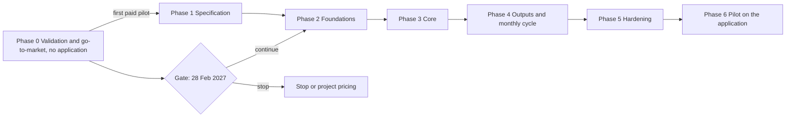

# Execution plan — PINT AE Readiness Desk

Phase → milestone → task → subtask. Requirements: [PRD.md](PRD.md). Go-to-market numbers: [Decision.md section 12](Decision.md#12-go-to-market-plan). Risks: [verification-report-fixing.md section 5](verification-report-fixing.md#5-production-risk-register). Nothing below has been done. Every script, command and environment is **proposed**. Estimates are hours, low–high, **[A]**. Owner roles: F = founder, D = developer, L = outside legal reviewer.

## 1. Sequence and critical path

- **Critical path:** T-0.1.2 (legal answers) and T-0.1.5 (file store) → T-0.1.1 → T-0.2.1 → T-0.2.3 → T-0.3.1 → T-0.4.1 → T-2.2.2 → T-3.2.1 → T-3.2.3 → T-4.1.1 → T-5.1.1 → T-6.1.1.
- **Parallel:** T-0.1.3, T-0.1.6 and T-0.1.7 with T-0.1.1; T-1.1.4 with T-1.1.1; T-3.1.x with T-3.2.x once T-2.2.x is done; T-4.1.3 with T-4.1.1; all T-5.1.x.
- **External dependencies:** payment of the pilot invoice (T-0.3.1); sample data and client authority from the firm (T-0.2.3, T-0.3.2); the founder's gate decision (T-0.4.1); written answers to legal questions LQ-1 to LQ-5 (T-0.1.2), without which nothing is sent and no file is received; a UAE-region account (T-0.1.5, reused by T-2.1.4); a second checker (T-0.3.4).
- **No build task starts before the first pilot fee is received** (exit of M0.3). Phases 2 onward also wait for the gate.

## 2. Phase 0 — Validation and go-to-market (no application)

**M0.1 List, rule workbook, paperwork, gates.** Entry: this repository approved; starts 16 November 2026. Depends on: a UAE-qualified lawyer engaged in week 1 and answering by 11 December 2026 **[A]**. Founder effort 58–90 hours. Owner: F. Outcome: a counted prospect list and the means to deliver by hand. Exit: distinct ICP firm count recorded; LQ-1 to LQ-5 answered in writing; file store passes its checks; fixtures exist and the workbook reproduces their expected findings; calendar sheet checked by a second person; agreement template reviewed; first weekly source check logged.

| ID | Need | Owner | Est | Deliverable | Acceptance check | Subtasks |
|---|---|---|---|---|---|---|
| T-0.1.1 | Decision §8 | F | 10–16 | Prospect sheet with distinct firms | Each row has firm, named partner, public email, emirate; duplicates by firm name and domain removed; count of distinct Dubai and Sharjah firms written into Decision §8 | Export FTA directory entries; add Zoho, Wafeq, ICAI, ProAdvisor rows; de-duplicate; tag ICP fit; count |
| T-0.1.2 | Decision §12 legal gate | F, L | 10–16 | Written legal answers LQ-1 to LQ-5; message set; sending domain; "not an ASP" wording | A UAE-qualified lawyer's written answer to each question, naming the instrument relied on; T-0.2.1 may start only for the channels cleared; if LQ-1 is refused, email is removed from T-0.2.1 and Decision §8 is marked not applicable; if LQ-4 is refused, T-0.2.3 uses anonymised files only | Send the five questions with Decision §12 and §5.2; draft messages; domain and verification; record answers in Decision §13 |
| T-0.1.3 | MH-06, MH-03 | F | 16–24 | Rule workbook: RC-01 to RC-20, outcomes including "not checked", and the calendar and provisions as spreadsheet formulas | Applied to fixtures FX-A and FX-B (T-0.1.6) it finds exactly the seeded defects of section 9; a second person re-derives every date on the calendar sheet from SRC-05 and SRC-06 and signs it | One sheet per dataset and one for the seller profile; calendar sheet with sources; fix-list template; report template with disclaimer and reference code |
| T-0.1.4 | Decision §5.2 | F, L | 6–10 | Pilot agreement, invoice template, data-handling note, delivery-log template | Contains price, term, refund criterion, data authority clause, processing location, deletion terms | Draft; legal review; decide invoicing entity (Decision §11 item 6) |
| T-0.1.5 | R-13, R-14; Decision §11 item 4 | F, D | 8–12 | UAE-region file store and written handling procedure for Phase 0 | Bucket in a UAE region with encryption at rest, no public access, access logging; one named user with multi-factor sign-in; files are opened only inside a UAE-region virtual desktop, never downloaded to a laptop; a test file is uploaded, worked, deleted, and the deletion appears in the log; the procedure names who is told, and how fast, if a file is exposed; LQ-4 answered. No client file before this passes | Create account and bucket; virtual desktop; per-firm, per-entity prefixes as in schema.md; deletion log; incident step; add terms to T-0.1.4 |
| T-0.1.6 | T-0.1.3, all tests | F | 8–12 | Synthetic fixtures FX-A and FX-B as spreadsheets with a written list of expected findings | Contains no real name or number; expected findings counted per rule; a second person spot-checks 10 rows | Build files; seed the defects of section 9; write expectations |
| T-0.1.7 | MH-12, R-21 | F | 1 a week, from week 1 | Weekly check of MoF and OpenPeppol publications | Dated log entry each week listing the version and date of SRC-01 to SRC-06 and SRC-10 to SRC-12 as found; any change stops hand reports until the workbook is updated and re-checked against the fixtures | Read the sources; record versions; update workbook or open a rule-pack task |

**M0.2 Outreach and discovery.** Entry: M0.1 exit. Depends on: T-0.1.1, T-0.1.2. Owner: F. Outcome: the funnel measured against Decision §8. Exit: 800 first touches sent or the list exhausted; every call has an SR-2 answer.

| ID | Need | Owner | Est | Deliverable | Acceptance check | Subtasks |
|---|---|---|---|---|---|---|
| T-0.2.1 | Decision §12 | F | 40 | Weekly cohorts of 100 from the first-send date: 14 December 2026 at the earliest **[A]**, the Monday after T-0.1.2 and T-0.1.5 pass, and not later than 11 January 2027 (Decision §9); only on channels cleared by T-0.1.2 | Send log shows 100 distinct firms a week; bounces under 5%; every message carries the opt-out the lawyer specifies; the first-send date is written into Decision §9 and every dependent date recomputed from it | Day 0 email; day 3 LinkedIn; day 7 follow-up; day 14 last note |
| T-0.2.2 | SR-2, M-03 | F | 20–30 | Discovery calls using the brief's five questions plus the SR-2 question | Each call record holds client count, ledgers, ASP recommended, SR-2 answer, readiness-fee intent | Schedule in Dubai morning hours; record answers the same day |
| T-0.2.3 | Offer | F | 113 for 800 firms (25.2 checks × 3 entities × 1.5 h) | Hand-run free checks of 3 client files per firm | Starts only after T-0.1.5; result returned within 2 business days; files deleted or kept per the firm's written choice, with the deletion logged | Receive files into the T-0.1.5 store; apply workbook; send fix list; present on the call |
| T-0.2.4 | Decision §9 | F | 6–10 | Funnel log reviewed weekly | Replies, calls, proposals, payments by cohort; SR-4 evaluated on day 44 after the first send (26 January 2027 for a 14 December start) | Update sheet; compare with 7%, 45%, 20% |

**M0.3 Paid pilots delivered by hand.** Entry: a firm accepts. Depends on: T-0.1.4, payment, data. Owner: F. Outcome: first revenue and the first measured data. Exit: one pilot fee received and its first gap reports delivered inside the turnaround.

| ID | Need | Owner | Est | Deliverable | Acceptance check | Subtasks |
|---|---|---|---|---|---|---|
| T-0.3.1 | M-01 | F | 6–10 | Signed agreement and paid invoice | Signature by the managing partner; AED 1,500 received before day 1 | Send agreement; issue invoice; confirm receipt; open delivery log |
| T-0.3.2 | MH-06 to MH-11 and MH-15 by hand | F | 45 per pilot | Gap report per entity, weekly status sheet, handoff pack where earned, delivery log with slot, intake-complete and delivered times | M-04 computed from the log in UAE business days; slot schedule followed (10 entities per 2-business-day window across all pilots); the firm's Reviewer confirms each segment in writing; no report says Data-ready with a failed or unchecked mandatory field | Intake three exports and the seller profile; workbook run; fix list; re-check; report; day-30 and day-45 calls |
| T-0.3.3 | M-03, M-06 | F | 6–10 | Baseline and overlap record | Stopwatch time for 2 entities done the firm's way; "ASP also flagged" marked for entities in ASP onboarding | Agree method with the firm; record; store with the pilot file |
| T-0.3.4 | PRD §7 False Ready | Second checker (a developer or a contracted accountant; Decision §11 item 8) | 4.5 per pilot | Independent check of every hand-made report before release | For every entity: segment, both dates and calendar version re-derived from the sources and equal to the report; for 5 entities per pilot: findings re-performed from the files and equal; signed entry in the delivery log; a report without the entry is not sent | Check sheet; re-perform; sign; record differences |

**M0.4 Gate.** Entry: day 77 after the first send (28 February 2027 for a 14 December 2026 start), or SR-2 fired, or no first send by 11 January 2027. Depends on: T-0.2.4. Owner: F. Outcome: a recorded decision. Exit: continue, stop, or project pricing, written with the numbers.

| ID | Need | Owner | Est | Deliverable | Acceptance check | Subtasks |
|---|---|---|---|---|---|---|
| T-0.4.1 | SR-1, SR-2, SR-4 | F | 2–4 | Gate record | States paid pilots, SR-2 tally, replies, and the decision; a single paid pilot follows the day-91 recount (14 March 2027) | Count; decide; update Decision §1 |
| T-0.4.2 | SR-3, M-02 | F | 2–4 | Month-3 record for the first 3 pilots | Each pilot marked paid month 3 or not, with the reason given by the partner | Day-45 call; day-55 invoice; day-60 count |

**How a paid pilot is delivered before software exists:** T-0.3.2, checked by T-0.3.4, on files held under T-0.1.5, with the sources watched by T-0.1.7. Capacity is 10 entities per 2-business-day window and 3 concurrent pilots (Decision §5.2); a fourth is given later slots or triggers the internal runner (T-3.2.1 run from the command line by the founder).

## 3. Phase 1 — Specification and design

**M1.1 Specified rules, fixtures and screens.** Entry: M0.3 exit. Depends on: T-0.1.3. Owner: D. Outcome: testable rule data and sketches. Exit: fixture expectations reviewed against the sources; five wireframes walked through with one pilot Reviewer.

| ID | Need | Owner | Est | Deliverable | Acceptance check | Subtasks |
|---|---|---|---|---|---|---|
| T-1.1.1 | MH-06, MH-12 | D | 12–18 | RP-1 data file: 20 rules with applicability, severity, source references | Every rule cites a source line; reviewed against SRC-03 and SRC-12 by a second person | Transcribe from workbook; add applicability; hash |
| T-1.1.2 | MH-03 | D | 4–6 | Calendar files CAL-1, CAL-2 with the recorded discrepancy, the SEG-U and SEG-N rows, and provisions PRV-1 to PRV-4 | UT-10, UT-16 and UT-18 expectations derivable from the file alone; reviewed against SRC-05 and SRC-06 by a second person | Encode segments, dates, bases, provisions, sources |
| T-1.1.3 | All tests | D | 10–16 | Fixtures FX-A and FX-B (from T-0.1.6) converted to machine-readable form; FX-C to FX-E added | Expected findings listed per fixture; no real names or numbers | Convert; generate; seed defects; write expectations |
| T-1.1.4 | S-04, S-06, S-08, S-10, S-12 | D | 12–20 | Wireframes | Each shows the states of App-flow §4 | Draw; review with a pilot Reviewer |
| T-1.1.5 | MH-08 | D | 4–6 | Status decision table | Covers every combination in UT-11 | Enumerate; review |

## 4. Phases 2 to 6 — Build, test, pilot

**M2.1 Repository and environments.** Entry: gate passed. Depends on: UAE-region account. Owner: D. Outcome: a clean checkout runs. Exit: OPS-04 passes locally; staging answers `/readyz`.

| ID | Need | Owner | Est | Deliverable | Acceptance check | Subtasks |
|---|---|---|---|---|---|---|
| T-2.1.1 | R-03, R-04, R-06, R-07 | D | 6–10 | Monorepo skeleton with import-boundary lint | ARCH-01 fails on a seeded cross-app import and on a web import inside `packages/core` | Layout of TRD §5; lint rules; shared config and logging modules |
| T-2.1.2 | R-17 | D | 6–10 | One start command with health checks | OPS-04 | Compose file; readiness covering database, storage, migrations, worker heartbeat |
| T-2.1.3 | R-21, R-22 | D | 4–8 | CI, protected `main`, branch naming, pull-request template | GOV-01, GOV-02 | Lint, tests, migration checks; `type/T-x.y.z-slug` names; auto-delete merged branches |
| T-2.1.4 | R-15, R-16 | D | 10–16 | Staging and production in the UAE region, in the account opened by T-0.1.5 | OPS-03, OPS-05 | Database with backups; versioned bucket; secrets; `PUBLIC_BASE_URL` validation |

**M2.2 Schema, tenancy, identity, jobs.** Entry: M2.1 exit. Owner: D. Outcome: a safe base. Exit: IT-01, IT-02, IT-04, IT-05, IT-11, IT-16, IT-18, IT-21 pass.

| ID | Need | Owner | Est | Deliverable | Acceptance check | Subtasks |
|---|---|---|---|---|---|---|
| T-2.2.1 | R-08, R-09, R-10, R-11 | D | 12–18 | Migrations, models, parity and single-head checks | IT-11 | Tables of schema.md; concurrent index helper; resumable backfill pattern |
| T-2.2.2 | MH-01, R-05 | D | 10–16 | Row-level security and the tenancy session | IT-01 | Policies; API and worker roles; 404 mapping; audit on denial |
| T-2.2.3 | MH-01 | D | 22–32 | Password, TOTP, sessions, invitations, recovery (S-18), vendor identities and support session | IT-16, IT-02, IT-18, IT-21 | TRD §8.1; rate limits; role checks at the service layer; recovery codes; reset links; Owner reset; vendor sign-in and grant check |
| T-2.2.4 | MH-14, R-12 | D | 8–12 | Audit events and structured logs with correlation identifiers | IT-10 | Insert-only grant; log field allow-list |
| T-2.2.5 | R-01, R-02 | D | 12–18 | Job table, worker, leases, compare-and-set transitions | IT-04, IT-05 | Claim; heartbeat; attempt identifiers; sweeper |
| T-2.2.6 | R-13, R-14 | D | 6–10 | Storage key builder and expiry sweeper | IT-15, IT-09 | Key scheme; sweeper job; orphan scan; alert |

**M3.1 Ingest.** Entry: M2.2 exit. Owner: D. Outcome: files become mapped rows. Exit: IT-03, IT-06, IT-08 pass; FX-C and FX-D map with the dictionary.

| ID | Need | Owner | Est | Deliverable | Acceptance check | Subtasks |
|---|---|---|---|---|---|---|
| T-3.1.1 | MH-04, R-19 | D | 16–24 | Upload endpoint and parsers | IT-03, IT-06, IT-08 | Type and size checks; hash; per-file states; staged rows |
| T-3.1.2 | MH-05 | D | 18–28 | Dictionary mapper, fingerprints, value tables, "absent" marking, Reviewer approval | First-suggestion accuracy measured on FX-A to FX-D and recorded; IT-02 mapping case | Synonyms; type sniffing; reuse by fingerprint; versioning; approval state |
| T-3.1.3 | S-07, S-08 | D | 14–22 | Upload and mapping screens | E2E-01 steps 2–3; A11Y-01 | Drop zone with button; mapping table; value tabs; draft autosave |

**M3.2 Rules, segments, status.** Entry: M2.2 exit and T-1.1.1 to T-1.1.5. Owner: D. Outcome: correct, reproducible results. Exit: UT-01 to UT-19 and IT-07, IT-12, IT-13, IT-17 pass.

| ID | Need | Owner | Est | Deliverable | Acceptance check | Subtasks |
|---|---|---|---|---|---|---|
| T-3.2.1 | MH-06 | D | 24–36 | Rule engine and RP-1; command-line runner for the founder | UT-01 to UT-09, UT-12, UT-14 | Decimal arithmetic; applicability; fingerprints; out-of-scope handling |
| T-3.2.2 | MH-02, MH-03 | D | 8–12 | Segment function and calendar lookup | UT-10, UT-13, UT-16 | Pure functions; Asia/Dubai dates; SEG-U handling |
| T-3.2.3 | MH-08 | D | 8–12 | Status function, snapshots and the `entity_status` derivation of staleness on read (a read function, not a SQL view, since B1) | UT-11, UT-17, IT-17 | One function in `packages/rules`; snapshot write in the run transaction; read-time derivation; no stored stale flag |
| T-3.2.4 | MH-12 | D | 8–12 | Publication with its two steps, `notify_stale` notices, approval pin guard | IT-07, IT-12, IT-13, IT-17 | Publish routes; `publications` row; notices; 409 on stale pins |

**M3.3 Work surfaces.** Entry: M3.1 and M3.2 exits. Owner: D. Outcome: the Preparer and Reviewer can work unaided. Exit: E2E-01, E2E-03, E2E-05, E2E-08 pass.

| ID | Need | Owner | Est | Deliverable | Acceptance check | Subtasks |
|---|---|---|---|---|---|---|
| T-3.3.1 | MH-09, MH-10, R-18 | D | 12–18 | Dashboard S-04 with URL state, risk sort and batch re-run | E2E-03, E2E-08; LOAD-02 | Tiles; filters in URL; overdue-first sort with SEG-U and SEG-N rules; per-item batch results |
| T-3.3.2 | MH-02, MH-03 | D | 12–18 | Entity and segment screens S-05, S-06 | E2E-05; IT-13 | Unknown values accepted; proposal and approval; version history |
| T-3.3.3 | MH-06, MH-07 | D | 18–28 | Run and fix-list screens S-09, S-10, exceptions | E2E-02; UT-14 | Polling; drawer; exception propose and decide; "ASP also flagged" |
| T-3.3.4 | MH-10 | D | 4–8 | ASP status S-11 | Past-date appointment accepted and flagged | Form; history; dashboard column |

**M4.1 Outputs and governance.** Entry: M3.3 exit. Owner: D. Outcome: approved reports and data controls. Exit: E2E-04, IT-14, IT-19, IT-20 pass.

| ID | Need | Owner | Est | Deliverable | Acceptance check | Subtasks |
|---|---|---|---|---|---|---|
| T-4.1.1 | MH-11 | D | 14–22 | Report draft, approval, supersede (S-12) | E2E-04, IT-07 | Template with disclaimer; pins; immutability trigger; diff |
| T-4.1.2 | MH-07, MH-15 | D | 8–14 | Fix-list and dashboard exports; generic handoff pack | UT-15; IT-19 | Cell escaping; pack layout; refusal reasons; expiry |
| T-4.1.3 | MH-14 | D | 14–22 | Users, data and audit screens S-15, S-16; export; deletion | IT-14, IT-20 | Invitations; grants; export job; deletion with replay after restore |
| T-4.1.4 | MH-03, MH-12 | D | 4–6 | Rules and calendar screen S-14 | Every row shows a source; NAV-01 | Read-only lists; version differences |

**M4.2 Monthly cycle.** Entry: M4.1 exit; at least one pilot past day 30. Owner: D. Outcome: the recurring job can be tested. Exit: E2E-06 passes.

| ID | Need | Owner | Est | Deliverable | Acceptance check | Subtasks |
|---|---|---|---|---|---|---|
| T-4.2.1 | MH-13 | D | 12–18 | Cycle screen S-13, rejection log | E2E-06 | Delta detection by record key; rejection form; close rule |
| T-4.2.2 | MH-13 | D | 4–8 | Monthly summary | Lists status changes in both directions for FX-A month 2 | Summary builder; file |

**M5.1 Hardening.** Entry: M4.1 exit. Owner: D. Outcome: evidence for the risks. Exit: every test in section 8 run and recorded.

| ID | Need | Owner | Est | Deliverable | Acceptance check | Subtasks |
|---|---|---|---|---|---|---|
| T-5.1.1 | R-05 | D | 8–12 | Permission and tenant suite | IT-01, IT-02 across every endpoint in TRD §5.1 | Endpoint inventory test; file and export paths; worker context |
| T-5.1.2 | R-01, R-02, R-19 | D | 8–12 | Concurrency and job suite | IT-04, IT-05, IT-06 | Fault injection; duplicate delivery; lease expiry |
| T-5.1.3 | R-09, R-11 | D | 8–12 | Migration and recovery suite | IT-11, OPS-01, OPS-02 | Interrupted backfill; restore; rollback |
| T-5.1.4 | design §7 | D | 8–12 | Accessibility checks | A11Y-01 to A11Y-07 recorded with findings | Keyboard; screen reader; greyscale; reflow at 320 px and 400% zoom; error focus; timeout warning; sign-in with a password manager |
| T-5.1.5 | TRD §10 | D | 6–10 | Load tests | LOAD-01 to LOAD-03 | Synthetic 250-entity firm; 200,000 lines |
| T-5.1.6 | R-20 | D | 3–5 | Route and link check | NAV-01 | Route table; link crawl; vocabulary review |

**M6.1 Release and operations.** Entry: M5.1 exit. Owner: D, F. Outcome: production ready for one firm. Exit: OPS-01, OPS-02 and OPS-06 pass on staging.

| ID | Need | Owner | Est | Deliverable | Acceptance check | Subtasks |
|---|---|---|---|---|---|---|
| T-6.1.1 | Release | D | 6–10 | Release checklist and first deployment | `/readyz` green; migration step logged | Tag; migrate; start; smoke test |
| T-6.1.2 | Monitoring | D | 6–10 | Alerts: job age, failed jobs, sweeper, backup age, error rate | Each alert fired once in staging and received | Thresholds; routing to founder and cover |
| T-6.1.3 | Restore | D | 4–6 | Restore drill | OPS-01 within 4 hours, loss at most 15 minutes | Restore to a new instance; replay deletions; verify counts |
| T-6.1.4 | Rollback | D | 3–5 | Rollback drill | OPS-02 | Redeploy previous tag; verify schema compatibility |
| T-6.1.5 | PRD §7 False Ready; TRD §7 | D, F | 4–6 | Incident procedure and the approvals freeze | OPS-06 | `approvals_frozen` flag and 503 path; query that lists reports by pins; Owner notice template; written runbook |

**M6.2 Pilot on the application.** Entry: M6.1 exit; a paying firm agrees to move. Owner: F. Outcome: the decisive question answered with product data. Exit: M-02 to M-08 reported for at least 2 firms.

| ID | Need | Owner | Est | Deliverable | Acceptance check | Subtasks |
|---|---|---|---|---|---|---|
| T-6.2.1 | Pilot | F, D | 6–10 | Hand-run pilots loaded into the application | Results equal the workbook's for the same files, or each difference explained | Re-upload; compare; walk the firm through |
| T-6.2.2 | PRD §9 | F | 6–10 | Pilot review per firm | Metrics with denominators; partner's decision recorded | Day-45 review; day-60 count |
| T-6.2.3 | MH-12, R-21 | F | 1 a week | The weekly source check of T-0.1.7, continued, now ending in a rule-pack or calendar publication | Log entry each week; a change opens a rule-pack or calendar task and a publication | Read SRC-01, SRC-10, SRC-11; record versions |
| T-6.2.4 | R-21, R-22 | F, D | 2 a week | Request triage and branch report | Every request accepted or declined with reason; no stale branch | Weekly review |

## 5. Proposed scripts

| Script | Purpose | Inputs | Outputs | Failure behaviour |
|---|---|---|---|---|
| `make dev` | Start every local service and wait for readiness | `.env` | Running stack, exit 0 | Non-zero exit naming the service that is not ready |
| `scripts/check_schema_parity` | Compare a database built from migrations with one built from models | None | Diff or "equal" | Non-zero on any difference or on two migration heads |
| `scripts/load_rulepack` | Validate and load a rule pack or calendar file | File path | Version row, hash | Refuses on failed fixtures, changed content under an existing code, or missing source references |
| `scripts/run_checks_cli` | Founder's internal runner | Three files, mapping file, pack code | Fix list and summary files | Non-zero with the offending file and row; writes nothing partial |
| `scripts/seed_synthetic` | Load FX-A to FX-E | Target environment (never production) | Seeded firm | Refuses when the environment is production |
| `scripts/restore_drill` | Restore and verify | Backup time | Row counts, deletion replay log | Non-zero if counts differ or a deleted entity reappears |
| `scripts/sweep_expired` | Remove expired and orphaned objects | None | Counts | Alerts and exits non-zero; safe to re-run |

## 6. Estimate and timeline

Build phases 1 to 6: 42–66, 96–150, 142–218, 56–90, 41–63, 35–57 = **412–644 hours**, excluding the weekly tasks (round 1 added recovery, vendor identity, mapping approval and the incident procedure: 12–16 hours). At 140 productive hours per developer-month **[A]** that is 2.9–4.6 months for one developer and about 1.0–1.5 months of calendar time for three. Valued at the site model's CAD 100 an hour it is CAD 41,200–64,400 = AED 109,642.75–171,383.33 (Decision §7.1, §7.6). Phase 0 is not in this figure: its founder hours are in Decision §12. The chat's "18 din" and the brief's 140 hours [C] cover roughly the internal runner alone (T-1.1.1 to T-1.1.3, T-3.1.1, T-3.2.1: 66–100 hours).

Consequence, stated plainly: with a first send on 14 December 2026, a first paid pilot expected near 19 January 2027 and the gate on 28 February 2027, one developer starting after the gate finishes between late May and mid-July 2027. The application cannot be in a firm's hands before the 31 March 2027 appointment date and may miss the 1 July 2027 go-live. Pilots that matter for 31 March are delivered by hand or with the internal runner. The application serves, at best, the go-live and the monthly cycle, which is the part of the offer with no evidence yet. Each week the Phase 0 gates slip moves all of this a week later.

## 7. Gates

| Gate | When | Passes if | Otherwise |
|---|---|---|---|
| A | First pilot fee received | T-0.3.1 done | No Phase 1 |
| B | Day 77 after the first send (28 February 2027 for a 14 December start) | SR-1 and SR-2 (Decision §9) | Stop |
| B0 | 11 January 2027 | First send has happened | Do not start the test in this form |
| C | Day 60 of the third pilot | SR-3 | Project pricing or stop; Phase 4.2 dropped |
| D | Before any firm uses production | M5.1 and M6.1 exits | No production data |

## 8. Tests

Fixtures in section 9. None has been run.

**Unit**

| ID | Fixture and action | Expected |
|---|---|---|
| UT-01 | RC-01 on `100234567800003`, `100234567800001`, `200234567800003`, a 14-digit value, `1002 3456 7800 003` | Pass; fail; fail; fail; pass after whitespace removal with the original shown |
| UT-02 | RC-02 on `1002345678`, `0002345678`, seller with neither identifier | Pass; fail; fail citing IBR-177-AE |
| UT-03 | RC-04 on `DXB`, `Dubai`, `DUB`; then approve the value mapping Dubai → DXB | Pass; outcome not checked (reason: value unmapped), counted as an open blocker; fail; after approval, pass |
| UT-04 | Customer classed consumer | Outcome out of scope; excluded from the score denominator |
| UT-05 | RC-07: UAE business buyer with no identifier; same with reason "client does not know"; foreign buyer | Fail; fail and no value invented; rule not applied |
| UT-06 | RC-08 on a code 480 invoice without buyer legal registration | Fail |
| UT-07 | RC-12: USD invoice without rate; rate `3.6725001` | Fail; fail |
| UT-08 | RC-14: unit `pcs` with an approved mapping to `H87`; unit `bundle` with no mapping; unit mapped to a code that is not in the list | Pass; not checked (reason: value unmapped), counted as an open blocker; fail |
| UT-09 | RC-17: 2,000 × 5.00 = 10,000.00, VAT 5% 500.00, total 10,500.00; then total 10,500.01; property test over random decimals | Pass; fail; no float drift |
| UT-10 | Segment function for each band and type | SEG-L 30 Oct 2026 and 1 Jan 2027; SEG-S 31 Mar 2027 and 1 Jul 2027; SEG-G 31 Mar 2027 and 1 Oct 2027; Person with unknown Revenue gives SEG-U: both outcomes returned, governing appoint-by 30 Oct 2026; government entity with unknown Revenue gives SEG-G; consumer-only gives SEG-X; newly established gives SEG-N with basis "before first invoice", overdue when first invoice state is issued, and "First invoice date needed" (overdue) when it is unknown; a Person with Revenue of exactly AED 50M gives SEG-U with both outcomes, governed by 30 Oct 2026 and flagged (added in the B1 review) |
| UT-11 | Status table: failed blocker; no failed blocker but buyer-TRN field marked "not in this file" (RC-07 not checked on every customer); no blocker with one accepted exception; clean but mapping not approved; clean, approved mapping, awaiting review; approved; approved then pack changed; segment unknown with zero findings; seller address unknown; clean file containing two self-billed invoices (code 389), before and after a Reviewer confirms them | Gaps open; **Checks incomplete, never Data-ready, score 0% for customers**; Exceptions open; Review pending and approval refused; Review pending; Data-ready; Stale; Segment not confirmed; Checks incomplete; Checks incomplete while unresolved, then Review pending with "2 not assessed" carried to the report |
| UT-12 | Same inputs and versions run twice | Identical result hash |
| UT-13 | Days remaining to 31 March 2027 evaluated at 2027-03-31T21:00Z | "Passed" (it is 1 April in Dubai) |
| UT-14 | Record with an accepted exception on RC-07 and an invalid emirate | RC-06 (buyer emirate) finding still produced; corrected in B1 from RC-04, which checks the seller profile, not a customer record |
| UT-15 | Export a finding whose value is `=HYPERLINK("x")` | Cell is text, not a formula |
| UT-16 | Calendar CAL-2, SEG-L | Date 30 October 2026 with the recorded guideline discrepancy |
| UT-17 | Data-ready result whose newest data is 45 days old, then 46, with no job running | Data-ready; Stale |
| UT-18 | Invoice to a VAT-group member dated 31 December 2028; same dated 1 January 2029; same dated 31 December 2026 | Grace period (PRV-2), outside the denominator; checked normally; checked normally |
| UT-19 | Business-day turnaround: complete Thursday 17:00 Dubai, delivered Monday 16:00; same with the Friday listed as a holiday; delivered Tuesday 09:00 with no holiday | 2 days, inside; 1 day, inside; 3 days, outside |

**Integration**

| ID | Fixture and action | Expected |
|---|---|---|
| IT-01 | User of firm B requests firm A's entity, upload, finding, report and file; worker in firm A's context selects firm B rows | 404 each with an audit event; 0 rows |
| IT-02 | Preparer calls segment decision, mapping decision, value-table decision, exception decision, manual-review resolution, report approval, cycle close, user reset | 403 each |
| IT-03 | Same bytes uploaded twice for one entity and dataset; then for another entity | One upload row; a separate row |
| IT-04 | Deliver job events out of order and twice; complete from a superseded attempt | State never regresses; superseded completion discarded and logged |
| IT-05 | Client stops polling; job finishes; then a lease expires and a new attempt starts before the old one reports | Result visible on next read; old attempt's result discarded |
| IT-06 | Upload FX-A's three files with FX-E; retry; batch re-run of six stale entities with one forced failure | 3 parsed, 1 rejected with reason; retry touches only the failed one; per-entity outcomes |
| IT-07 | Publish RP-2 between run and approval | 409; after re-run approval succeeds; earlier report superseded |
| IT-08 | 21 MB file; .xlsx expanding to 300 MB; .xlsx with an external entity; macro file renamed .xlsx | Each rejected with a specific reason; worker stays healthy |
| IT-09 | Files past expiry, one orphan object, one forced sweeper failure | Removed; removed; alert raised and next run succeeds |
| IT-10 | Run FX-A; search logs for `100234567800003` and a customer name; follow one correlation identifier | 0 matches; same identifier on request, job and retry |
| IT-11 | Parity check; two migration heads; backfill interrupted at 40%; index added to `findings` under write load | Equal; CI fails; resumes to 100% without duplicates; no statement waits beyond 5 seconds |
| IT-12 | Publish a pack that fails a fixture; a pack whose content changed under the same code; a valid pack | Refused; refused; published and entities marked Stale |
| IT-13 | Approve a new segment version moving an entity from SEG-S to SEG-L | Displayed dates change at once; the entity reads as Stale (derived on read, nothing stored); approved reports read as Superseded |
| IT-14 | Delete an entity; restore yesterday's backup | Objects and rows gone; deletion replayed before reopening |
| IT-15 | Two firms upload `customers.xlsx` | Distinct keys under each firm's prefix and purpose |
| IT-16 | Disable a signed-in user; leave a session idle 31 minutes; sign in without TOTP | Session ended; re-authentication required; refused |
| IT-17 | Publish RP-2 with the `notify_stale` job disabled, then read dashboard, entity, report lookup | Entity shows Stale; approved report shows Superseded; approval returns 409; an alert fires for the failed job |
| IT-18 | Recovery: reset link used twice and after 21 minutes; reset completed without TOTP; recovery code used twice; Owner resets a Preparer; vendor Owner-reset completed before the 24-hour wait | Second and late use refused; no session issued; second use refused; new invitation issued and old sessions ended; refused |
| IT-19 | Request a handoff pack with one failed blocker on customers; with one not-checked blocker on items; with none | Refused with reason; refused with reason; pack built |
| IT-20 | Firm A requests an export while firm B has data; inspect every file in the ZIP | Only firm A identifiers; firm B's export link returns 404 for firm A |
| IT-21 | Vendor support user reads firm A with a valid grant, an expired grant, a revoked grant, and firm B with firm A's grant; attempts a write; publisher publishes with a hash that differs from the fixture run | Rows; 404; 404; 404; refused; refused; every attempt audited and visible to the Owner |

**End-to-end and operational**

| ID | Fixture and action | Expected |
|---|---|---|
| E2E-01 | Paid-pilot promise: Preparer adds FX-A, uploads three files, confirms mapping, runs, exports the fix list; Reviewer approves the segment and the report | Seeded defects all listed with source cells; report approved with pins; dashboard row correct |
| E2E-02 | False Ready path: (a) clear all FX-A blockers but leave one accepted exception; (b) clear the exception but mark buyer TRN "not in this file" and re-run; (c) restore the column, reach Data-ready, then publish RP-2 | (a) Exceptions open, report cannot say Data-ready; (b) Checks incomplete, approval as Data-ready impossible, handoff pack refused; (c) Stale and approval blocked |
| E2E-03 | Filter the fix list, open a finding, refresh, Back, open the copied URL in a new session | Same filter, position and finding each time |
| E2E-04 | Draft, approve, then change the mapping | Watermark on draft; approved file immutable; superseded band shown |
| E2E-05 | FX-B with Revenue unknown through upload and run | No number demanded; dashboard shows Segment not confirmed with both outcomes |
| E2E-06 | Month 2 for FX-A: delta upload with 3 new customers, one rejection logged, close cycle | Only new records checked as delta; summary lists changes; cycle closed by the Reviewer |
| E2E-07 | Session expires on a finding deep link | S-17, then return to the same finding after sign-in |
| E2E-08 | Dashboard with five entities: SEG-S appointed; SEG-S not appointed; SEG-L not appointed; SEG-U (Person, Revenue unknown) not appointed; SEG-N with first invoice issued, not appointed. Evaluated on 15 January 2027 | Order: SEG-L, SEG-U and SEG-N in the overdue group (SEG-U showing both outcomes), then SEG-S not appointed, then SEG-S appointed; "past appoint-by without ASP" tile counts 3 |
| LOAD-01, LOAD-02, LOAD-03 | TRD Q-01; Q-02 and Q-07; Q-03 | Targets met or the gap recorded |
| OPS-01, OPS-02 | Restore drill; rollback drill | TRD Q-04; previous tag serves with current schema |
| OPS-03 | Recreate all containers in staging and locally | Database, objects and proxy certificate data intact |
| OPS-04 | Clean checkout, `make dev`; then with the database stopped | Healthy within 3 minutes; fails naming the database |
| OPS-05 | Invitation email link and a report download behind the proxy; start with a bad `PUBLIC_BASE_URL` | Public HTTPS host in both; start refused |
| OPS-06 | Incident drill on staging: publish a deliberately wrong pack, set the freeze, list affected reports, send the notice, publish the correction, clear the freeze | Approvals return 503 while frozen; the list equals the reports pinned to the wrong pack; elapsed time recorded |
| A11Y-01 to A11Y-04 | design.md §7: keyboard and focus; status announcements and table semantics; greyscale and contrast; reflow at 320 CSS px and 400% zoom including a complete upload and mapping, and target size | Each criterion recorded pass or fail with evidence |
| A11Y-05 | Submit invalid input on S-01, S-06, S-07, S-08; approve on S-12 | Focus on the first error; message names field and fix; review step before approval; no re-entry of data already given |
| A11Y-06 | Leave a session idle to 28 minutes | Warning announced with "Stay signed in"; choosing it keeps the session |
| A11Y-07 | Sign in and recover with a password manager and pasted codes | No transcription or puzzle step required |
| ARCH-01 | Seed a cross-app import, a copied config module in `apps/worker`, and a web import in `packages/core` | Lint fails on each |
| NAV-01 | Crawl every route and link, including links inside generated reports | No broken link; removed routes redirect |
| GOV-01, GOV-02 | Inspect merged pull requests and branches | Each cites an MH, R or task ID; no unmerged branch older than 14 days without an open pull request |

## 9. Synthetic fixtures

| ID | Content | Seeded defects |
|---|---|---|
| FX-A | "Al Noor Trading LLC", VAT-registered, Excel: 40 customers, 25 items, 300 invoices | 6 buyers without TRN or TIN, 3 with emirate "Dubayy", 4 items with unit "pcs", 2 arithmetic mismatches, 1 duplicate invoice number, 5 consumer buyers |
| FX-B | "Sharjah Fresh Foods", not VAT-registered, commercial invoices, Revenue unknown | 4 invoices without buyer legal registration; seller TIN `0002345678` |
| FX-C | QuickBooks-style export headers, USD invoices | 2 without exchange rate |
| FX-D | Odoo-style export headers with two header rows | Header row must be chosen |
| FX-E | Corrupt .xlsx | Parse failure |
