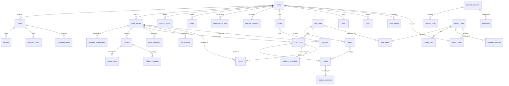

# Schema — PINT AE Readiness Desk

Proposed PostgreSQL 16 schema. Requirements: [PRD.md](PRD.md). Architecture decisions: [TRD.md section 9](TRD.md#9-architecture-decisions). Nothing has been created. Types: `uuid` keys generated by the database, `timestamptz` in UTC, `date` for legal dates (interpreted in Asia/Dubai), `numeric(18,6)` for amounts and quantities, `text` with check constraints for enumerations.

## 1. Entity-relationship diagram

## 2. Dictionary

Every tenant table has `id uuid PK`, `firm_id uuid NOT NULL FK firms`, `created_at timestamptz NOT NULL DEFAULT now()`, `created_by uuid NULL FK users` unless stated. "T" marks tenant tables under row-level security.

| Table | Fields beyond the common ones (type, nullability, default, constraint) |
|---|---|
| `firms` | `legal_name text NOT NULL`; `plan text NOT NULL DEFAULT 'pilot'` in (pilot, starter, pro, business); `plan_limit int NOT NULL DEFAULT 30`; `pilot_starts_on date NULL`; `authority_confirmed_at timestamptz NULL`; `report_footer text NULL`; `logo_file_id uuid NULL FK files`; `recovery_phone text NULL`; `recovery_email citext NULL`; `deleted_at timestamptz NULL` |
| `users` T | `email citext NOT NULL`; `role text NOT NULL` in (owner, reviewer, preparer); `password_hash text NOT NULL`; `totp_secret_enc bytea NOT NULL` (key in the secret store); `disabled_at timestamptz NULL`. Unique (`email`) globally. Vendor staff are not in this table |
| `recovery_codes` T | `user_id uuid NOT NULL FK ON DELETE CASCADE`; `code_hash text NOT NULL` (salted password hash); `used_at timestamptz NULL`. Ten per user; regenerating deletes the old set |
| `password_resets` T | `user_id uuid NOT NULL FK`; `token_hash bytea NOT NULL UNIQUE`; `expires_at timestamptz NOT NULL` (20 minutes); `used_at timestamptz NULL` |
| `owner_resets` | Not under tenant policy; written by vendor routes. `firm_id uuid NOT NULL FK`; `vendor_user_id uuid NOT NULL FK`; `callback_done_at timestamptz NOT NULL`; `earliest_complete_at timestamptz NOT NULL` (callback + 24 h); `completed_at timestamptz NULL`; `invite_id uuid NULL` |
| `vendor_users` | Global. `email citext UNIQUE`; `role text NOT NULL` in (publisher, support); `password_hash`, `totp_secret_enc` as above; `disabled_at timestamptz NULL` |
| `invites` T | `email citext NOT NULL`; `role text NOT NULL`; `token_hash bytea NOT NULL UNIQUE`; `expires_at timestamptz NOT NULL`; `used_at timestamptz NULL` |
| `sessions` T | `user_id uuid NOT NULL FK`; `token_hash bytea NOT NULL UNIQUE`; `last_seen_at`, `absolute_expires_at timestamptz NOT NULL`; `ended_at timestamptz NULL` |
| `support_grants` T | `granted_by uuid NOT NULL FK users`; `vendor_user_id uuid NOT NULL FK vendor_users`; `scope text NOT NULL` in (firm, entity); `entity_id uuid NULL`; `expires_at timestamptz NOT NULL`; `revoked_at timestamptz NULL` |
| `client_entities` T | The seller profile. `legal_name text NOT NULL`; `registration_type text NOT NULL DEFAULT 'unknown'` in (TL, EID, PAS, CD, unknown); `licence_number text NULL`; `licence_authority text NULL`; `passport_country text NULL`; `address_line text NULL`; `city text NULL`; `emirate_code text NULL` in (AUH, DXB, SHJ, UAQ, FUJ, AJM, RAK); `country_code text NULL`; `vat_registered text NOT NULL DEFAULT 'unknown'` in (yes, no, unknown); `trn text NULL` check 15 digits; `tin text NULL` check 10 digits; `source_ledger text NOT NULL`; `current_segment_assessment_id uuid NULL`; `intake_slot_at timestamptz NULL`; `intake_complete_at timestamptz NULL` (set once, when the third dataset parses and the profile exists); `profile_version int NOT NULL DEFAULT 1`; `deleted_at timestamptz NULL`. Unique (`firm_id`, `trn`) where `trn` is not null and `deleted_at` is null |
| `segment_assessments` T | `entity_id uuid NOT NULL FK`; `version int NOT NULL`; `entity_type text NOT NULL` in (person, government_entity); `newly_established bool NOT NULL DEFAULT false`; `first_invoice_state text NULL` in (issued, not_yet, unknown); `first_invoice_on date NULL`; `b2c_only bool NOT NULL DEFAULT false`; `revenue_band text NOT NULL` in (ge_50m, lt_50m, unknown); `period_end date NULL`; `evidence_type text NULL` in (financial_statements, other_documentation, client_statement); `segment text NOT NULL` in (SEG-L, SEG-S, SEG-G, SEG-N, SEG-X, SEG-U); `state text NOT NULL` in (proposed, approved, returned); `decided_by uuid NULL`; `decided_at timestamptz NULL`; `note text NULL`. Unique (`entity_id`, `version`). The rule that the decider holds the Reviewer or Owner role is enforced in the service layer and by a trigger that reads `users.role`; it cannot be a CHECK constraint. No calendar version is stored: dates are always read from the current calendar |
| `calendar_versions` | Global. `code text UNIQUE` (CAL-1, CAL-2, …); `basis text NOT NULL`; `source_refs jsonb NOT NULL`; `effective_from date NULL`; `effective_label text NOT NULL` in (stated, assumed); `status text NOT NULL` in (draft, published, withdrawn); `content_hash bytea NOT NULL`; `published_at timestamptz NULL` |
| `calendar_rules` | Global. `calendar_version_id uuid NOT NULL FK`; `segment text NOT NULL`; `deadline_basis text NOT NULL` in (fixed_date, before_first_invoice, not_subject, earliest_of_candidates); `appoint_by date NULL`; `implement_by date NULL`; `candidate_segments text[] NULL` (for SEG-U: SEG-L, SEG-S); `note text NULL`; `discrepancy text NULL`. Unique (`calendar_version_id`, `segment`) |
| `provisions` | Global. `calendar_version_id uuid NOT NULL FK`; `code text NOT NULL` (PRV-1 …); `kind text NOT NULL` in (grace_period, voluntary_phase, pending_requirement, residual_scope); `applies_from date NULL`; `applies_to date NULL`; `selector jsonb NOT NULL` (for PRV-2: buyer class `vat_group_member`); `effect text NOT NULL` in (exclude_from_denominator, note_only, activate_rule); `rule_code text NULL`; `source_refs jsonb NOT NULL`. Unique (`calendar_version_id`, `code`) |
| `rule_packs` | Global. `code text UNIQUE` (RP-1, …); `basis text NOT NULL`; `released_on date NOT NULL`; `effective_from date NULL`; `effective_label text NOT NULL`; `status`; `content_hash`; `published_at` as above |
| `rules` | Global. `rule_pack_id uuid NOT NULL FK`; `code text NOT NULL` (RC-01 …); `severity text NOT NULL` in (blocker, warning); `applies_to jsonb NOT NULL` (dataset including `seller_profile`, document types, seller VAT status, buyer class); `valid_from date NULL`; `valid_to date NULL` (compared with the invoice date); `source_refs jsonb NOT NULL`; `description text NOT NULL`. Unique (`rule_pack_id`, `code`) |
| `publications` | Global. `object_type text NOT NULL` in (rule_pack, calendar_version); `object_id uuid NOT NULL`; `content_hash bytea NOT NULL`; `fixture_run_ref text NOT NULL`; `fixture_hash bytea NOT NULL` (must equal `content_hash`); `confirmed_by uuid NOT NULL FK vendor_users`; `confirmed_at timestamptz NOT NULL` |
| `system_flags` | Global. `key text PK` (`approvals_frozen`); `value bool NOT NULL`; `reason text NULL`; `set_by uuid NOT NULL FK vendor_users`; `set_at timestamptz NOT NULL` |
| `business_holidays` | Global. `day date PK`; `label text NOT NULL`; `source_note text NOT NULL`; `added_by uuid NOT NULL FK vendor_users` |
| `uploads` T | `entity_id uuid NOT NULL FK`; `dataset text NOT NULL` in (customers, items, invoices); `sha256 bytea NOT NULL`; `storage_key text NOT NULL UNIQUE`; `original_name text NOT NULL`; `byte_size bigint NOT NULL`; `row_count int NULL`; `header_fingerprint bytea NULL`; `period_from`, `period_to date NULL`; `state text NOT NULL` in (received, parsed, rejected, removed); `reject_reason text NULL`; `expires_at timestamptz NULL`. Unique (`firm_id`, `entity_id`, `dataset`, `sha256`) |
| `staged_rows` T | `upload_id uuid NOT NULL FK ON DELETE CASCADE`; `sheet text NULL`; `row_number int NOT NULL`; `cells jsonb NOT NULL`; `record_key text NULL`. Unique (`upload_id`, `sheet`, `row_number`). Partitioned by hash of `firm_id` |
| `column_mappings` T | `upload_id uuid NOT NULL FK`; `version int NOT NULL`; `header_fingerprint bytea NOT NULL`; `mapping jsonb NOT NULL` (per target field: a source column, or `absent`); `suggested_by text NOT NULL DEFAULT 'dictionary'`; `state text NOT NULL` in (draft, confirmed, approved, returned, replaced); `confirmed_by uuid NULL`; `confirmed_at timestamptz NULL`; `approved_by uuid NULL`; `approved_at timestamptz NULL`. Unique (`upload_id`, `version`). Approval by Reviewer or Owner only (service layer and trigger) |
| `value_mappings` T | `entity_id uuid NOT NULL FK`; `kind text NOT NULL` in (unit, emirate, tax_treatment, document_type, buyer_class); `source_value text NOT NULL`; `target_code text NULL`; `state text NOT NULL` in (suggested, confirmed, approved); `approved_by uuid NULL`. Unique (`entity_id`, `kind`, `source_value`) |
| `check_runs` T | `entity_id uuid NOT NULL FK`; `rule_pack_id`, `segment_assessment_id uuid NOT NULL FK`; `profile_version int NOT NULL`; `inputs jsonb NOT NULL` (upload ids, mapping versions, hashes); `input_hash bytea NOT NULL`; `newest_data_on date NOT NULL`; `state text NOT NULL` in (queued, running, succeeded, failed); `result_hash bytea NULL`; `finished_at timestamptz NULL`. Unique (`entity_id`, `input_hash`) |
| `findings` T | `run_id uuid NOT NULL FK ON DELETE CASCADE`; `entity_id uuid NOT NULL`; `rule_id uuid NOT NULL FK`; `dataset text NOT NULL`; `record_key text NOT NULL`; `upload_id uuid NOT NULL`; `sheet text NULL`; `row_number int NOT NULL`; `column_name text NULL`; `value_found text NULL`; `outcome text NOT NULL` in (fail, not_checked, manual_review, out_of_scope, grace_period); `review_resolution text NULL` in (confirmed_self_billed, type_corrected); `resolved_by uuid NULL`; `resolved_at timestamptz NULL` (Reviewer or Owner only, by trigger); `not_checked_reason text NULL` in (field_absent, column_unmapped, value_unmapped, profile_unknown); `asp_also_flagged bool NOT NULL DEFAULT false`; `fingerprint bytea NOT NULL` (rule code + dataset + record key + field). Unique (`run_id`, `fingerprint`) |
| `finding_exceptions` T | `entity_id uuid NOT NULL`; `fingerprint bytea NOT NULL`; `reason text NOT NULL`; `state text NOT NULL` in (proposed, accepted, rejected, withdrawn); `decided_by uuid NULL`; `decided_at timestamptz NULL`; `rule_pack_id uuid NOT NULL`. Unique (`entity_id`, `fingerprint`, `rule_pack_id`) where state in (proposed, accepted). An exception attaches to a fingerprint, not a run, lapses when the pack changes, and cannot be created for a `not_checked` finding (trigger) |
| `readiness_snapshots` T | `run_id uuid NOT NULL UNIQUE FK`; `entity_id uuid NOT NULL`; `base_status text NOT NULL` (PRD section 5 statuses 1–8, as computed at run or approval time); `score_by_dataset jsonb NOT NULL`; `failed_blockers int NOT NULL`; `unchecked_blockers int NOT NULL`; `unresolved_manual_reviews int NOT NULL`; `not_assessed_self_billed int NOT NULL`; `accepted_exceptions int NOT NULL`; `mappings_approved bool NOT NULL`; `is_current bool NOT NULL`. Unique (`entity_id`) where `is_current`. Check: `base_status = 'data_ready'` requires `failed_blockers = 0 AND unchecked_blockers = 0 AND unresolved_manual_reviews = 0 AND accepted_exceptions = 0 AND mappings_approved`. No stale column: the effective status is derived on read by joining the run's pins to the current `rule_packs`, segment, mapping and profile versions and comparing `newest_data_on` with today (view `entity_status`) |
| `asp_statuses` T | `entity_id uuid NOT NULL FK`; `status text NOT NULL` in (not_appointed, appointed, onboarded, live); `asp_name text NULL`; `appointed_on date NULL`; `emaratax_done bool NOT NULL DEFAULT false`; `go_live_on date NULL`; `note text NULL`; `is_current bool NOT NULL` |
| `reports` T | `entity_id uuid NOT NULL FK`; `run_id uuid NOT NULL FK`; `reference_code text NOT NULL UNIQUE`; `state text NOT NULL` in (draft, approved); `pins jsonb NOT NULL`; `approved_by uuid NULL`; `approved_at timestamptz NULL`; `delivered_at timestamptz NULL`; `reissue_noted_at timestamptz NULL`; `file_id uuid NULL FK files`; `content_hash bytea NULL`. A trigger rejects updates to approved rows other than `delivered_at` and `reissue_noted_at`. Superseded is derived on read (pins against current versions), not stored |
| `files` T | `purpose text NOT NULL` in (report, fix_list, handoff, export, dashboard_export); `entity_id uuid NULL`; `storage_key text NOT NULL UNIQUE`; `sha256 bytea NOT NULL`; `expires_at timestamptz NULL` |
| `cycles` T | `month date NOT NULL` (first of month); `state text NOT NULL` in (open, closed); `closed_by uuid NULL`; `closed_at timestamptz NULL`; `summary jsonb NULL`. Unique (`firm_id`, `month`) |
| `rejections` T | `cycle_id uuid NOT NULL FK`; `entity_id uuid NOT NULL FK`; `invoice_number text NOT NULL`; `rejected_on date NOT NULL`; `cause text NOT NULL`; `asp_message text NULL`; `rule_code text NULL`. Unique (`entity_id`, `invoice_number`, `rejected_on`, `cause`) |
| `jobs` T | `kind text NOT NULL`; `payload jsonb NOT NULL`; `state text NOT NULL` in (queued, running, succeeded, failed, cancelled); `state_version int NOT NULL DEFAULT 0`; `attempt_id uuid NULL`; `attempts int NOT NULL DEFAULT 0`; `lease_expires_at timestamptz NULL`; `run_after timestamptz NOT NULL DEFAULT now()`; `correlation_id uuid NOT NULL`; `last_error_code text NULL` |
| `idempotency_keys` T | `key text NOT NULL`; `route text NOT NULL`; `request_hash bytea NOT NULL`; `response jsonb NOT NULL`; `expires_at timestamptz NOT NULL`. Unique (`firm_id`, `route`, `key`) |
| `audit_events` T | `actor_id uuid NULL`; `actor_kind text NOT NULL` in (user, vendor, system); `action text NOT NULL`; `object_type text NOT NULL`; `object_id uuid NULL`; `detail jsonb NOT NULL` (identifiers and versions only); `correlation_id uuid NOT NULL`. Insert-only grant |
| `deletion_requests` T | `scope text NOT NULL` in (entity, firm); `entity_id uuid NULL`; `execute_after timestamptz NOT NULL`; `state text NOT NULL` in (pending, running, done, cancelled) |

## 3. Indexes and their queries

| Index | Query served |
|---|---|
| `client_entities (firm_id, deleted_at)` | Dashboard list (S-04) |
| `readiness_snapshots (firm_id, base_status) WHERE is_current` | Dashboard tiles and status filter, through the `entity_status` view |
| `check_runs (entity_id, rule_pack_id, newest_data_on)` | Staleness derivation in `entity_status` |
| `reports (firm_id, reference_code)` | Report currency lookup (S-12) |
| `segment_assessments (entity_id, version DESC)` | Current and history on S-06 |
| `findings (entity_id, run_id, rule_id, outcome)` | Fix list grouped by rule (S-10) |
| `findings (entity_id, fingerprint)` | Matching a finding across runs for closure (M-05) and exceptions |
| `uploads (firm_id, entity_id, dataset, created_at DESC)` | Latest upload per dataset (S-05, S-07) |
| `column_mappings (firm_id, header_fingerprint) WHERE state = 'confirmed'` | Mapping reuse (MH-05) |
| `jobs (state, run_after) WHERE state = 'queued'` | Worker claim |
| `jobs (lease_expires_at) WHERE state = 'running'` | Lease sweeper |
| `asp_statuses (firm_id, status) WHERE is_current` | "Past appoint-by without ASP" tile |
| `audit_events (firm_id, created_at DESC)`; `audit_events (firm_id, object_type, object_id)` | Audit screen; object history |
| `files (expires_at)`, `uploads (expires_at)` | Expiry sweeper |

Constraints and indexes are declared in the ORM models and in migrations; a proposed CI check compares a database built from migrations with one built from the models (verification R-08).

## 4. Permissions, tenancy, uniqueness

| Object | Owner | Reviewer | Preparer | Vendor support (with grant) | Worker (service role) |
|---|---|---|---|---|---|
| Entities, uploads, mappings | read, write, delete | read, write | read, write | read | read, write within the job's firm |
| Segment assessment | propose, decide | propose, decide | propose | read | read |
| Column mapping | confirm, approve | confirm, approve | confirm | read | read |
| Value-table approval, exceptions, manual-review resolution | decide | decide | propose (not for manual review) | read | none |
| Recovery codes, password reset | own | own | own | none | none |
| Runs, findings | read, start | read, start | read, start | read | write |
| ASP status | write | write | read | read | none |
| Reports | draft, approve | draft, approve | draft | read | write file only |
| Cycle close | yes | yes | no | no | none |
| Users, grants, export, deletion | yes | audit read only | no | no | execute deletion job |
| Rule packs, calendar, provisions, holidays, flags | read | read | read | read; publish and flags need the vendor publisher role and a `publications` row | read |

- **Tenant boundary:** row-level security policy `firm_id = current_setting('app.firm_id')::uuid` on every T table, for the API role and the worker role alike. Global tables are read-only to both. Vendor support uses a third, read-only database role under the same policy; the firm setting is placed only by `core.tenancy.support_session`, which first verifies the `support_grants` row for that vendor user. Vendor publisher routes touch global tables only.
- **Cross-tenant denial:** a row outside the policy does not exist to the query; the API answers 404 and writes an audit event with the attempted identifier.
- **Uniqueness scope:** always includes `firm_id` except `users.email`, storage keys and token hashes.
- **Storage keys:** `firms/{firm_id}/entities/{entity_id}/{purpose}/{uuid}`; generated files use `firms/{firm_id}/generated/{purpose}/{uuid}`. Purposes for uploads: `source-customers`, `source-items`, `source-invoices`.

## 5. Provenance, versions, transactions, duplicates

- **Provenance:** every finding carries upload, sheet, row and column; every run carries pack, segment, mapping and seller-profile versions plus input hashes; every report copies them into `pins` and adds the calendar version whose dates it printed.
- **Timestamps:** creation on every row; decision times on assessments, exceptions, reports; publication on packs and calendars; legal dates as `date`.
- **Transaction boundaries:** (1) upload row and parse job; (2) findings, snapshot, previous snapshot's `is_current = false` and job success; (3) approval: compare pins, update report, insert audit; (4) publication: version row, `publications` row, `notify_stale` job; (5) segment decision: assessment and entity pointer (staleness and supersession follow on read); (6) mapping approval: mapping row, snapshot `mappings_approved`, audit.
- **Duplicates:** file hash per entity and dataset; run input hash; finding fingerprint per run; idempotency keys; rejection uniqueness. A duplicate invoice number inside client data is a finding (RC-09), not a constraint.
- **Audit history:** assessments, mappings, ASP statuses and reports are versioned rows, never updated in place apart from state fields; `audit_events` is insert-only.

## 6. Sensitivity and retention (all periods proposed)

| Class | Data | Retention |
|---|---|---|
| A, client commercial and personal data | Uploaded files, `staged_rows`, finding values, rejection messages | Until the entity is deleted, or 90 days after the account ends; source files of removed uploads 30 days |
| B, firm working records | Assessments, mappings, exceptions, snapshots, reports, ASP statuses | Life of the account plus 90 days |
| C, credentials | Password hashes, TOTP secrets, token hashes, recovery-code hashes, reset tokens | Until user removal; sessions 30 days after end |
| D, operational | Jobs, idempotency keys, logs | Jobs 90 days; keys 48 hours; logs 30 days |
| E, audit | `audit_events` | Life of the account plus 12 months, identifiers only |

- **Export:** `POST /exports` builds a ZIP of CSV files per table and the generated reports for one firm; expires after 7 days.
- **Deletion:** `delete_entity` removes storage objects first, then rows, then writes an audit event holding only the entity identifier; a firm deletion runs the same per entity after a 7-day delay.
- **Backup expiry:** database backups expire after 14 days and storage versions after 30, so deleted data persists in backups for at most 30 days; the pilot agreement says so.
- **Restore:** after any restore, `deletion_requests` in state `done` are replayed before the service reopens, so deleted data does not return.

## 7. Migrations

- **Ordering:** one linear Alembic history; a CI check fails on two heads (verification R-10). Global reference tables first, then firms and users, then entities, uploads, runs, reports, cycles.
- **ORM parity:** verification R-08.
- **Backfills:** separate, resumable jobs keyed by primary-key ranges with a progress row; safe to re-run; never inside the schema migration's transaction (R-09).
- **Locks:** new indexes on `staged_rows`, `findings` and `audit_events` are created concurrently, with a lock timeout of 5 seconds on other statements (R-11); columns are added nullable, backfilled, then constrained.
- **Partial execution:** each migration is transactional except concurrent index builds, which are checked for validity and rebuilt if invalid; rule pack and calendar loads are idempotent on `code` and `content_hash`.
